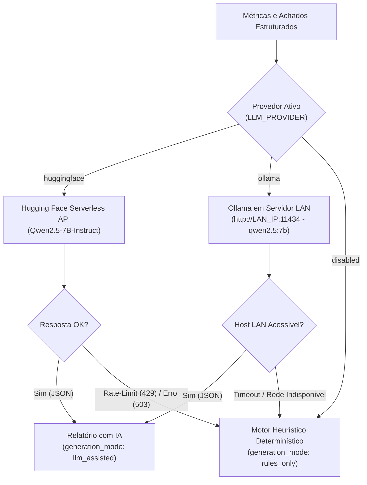

# Diretrizes para Agentes de Código e Desenvolvimento — DataGuard

Este documento estabelece as regras, padrões arquiteturais, contratos de interface e critérios de qualidade que devem ser rigorosamente seguidos por agentes de inteligência artificial e desenvolvedores que atuam no repositório **DataGuard**.

---

## 1. Regras Fundamentais de Operação

### 1.1 Separação Estrita de Responsabilidades e Camadas

- O sistema é dividido entre uma camada de interface desacoplada e três microsserviços de backend:
  1. `frontend`: Aplicação web Single-Page Application (SPA) em React, TypeScript, Vite e Tailwind CSS.
  2. `analysis-service`: Orquestrador de jobs, recepção de uploads, histórico e API pública.
  3. `data-quality-service`: Motor analítico tabular determinístico (Pandas/NumPy).
  4. `intelligence-service`: Agregador de relatórios e motor de síntese técnica (Regras determinísticas + LLM Híbrido).
- **Proibido criar novos microsserviços** sem solicitação explícita fundamentada nos requisitos da disciplina.
- Nenhuma lógica analítica de cálculo de dados deve ser executada no `analysis-service` ou no `frontend`.
- Nenhum cálculo matemático ou estatístico pode ser delegado a modelos de linguagem (LLMs).
- O `frontend` comunica-se exclusivamente com o `analysis-service` via HTTP REST. É terminantemente proibido o frontend acessar o banco PostgreSQL, o broker RabbitMQ ou os microsserviços internos diretamente.

### 1.2 Determinismo Analítico Estrito

- Todo perfilamento, contagem de nulos, desvios, frequências, duplicatas e achados de conformidade deve ser implementado via código determinístico utilizando **Pandas** e **NumPy** dentro do `data-quality-service`.
- Modelos de IA atuam única e exclusivamente na contextualização textual, sugestão de hipóteses de investigação e redação de resumos executivos.

### 1.3 Segurança, Credenciais e Higiene de Dados

- **Zero Segredos no Código:** Nenhuma chave de API, credencial de banco, senha do RabbitMQ, token da Hugging Face ou IP da rede interna deve ser fixado no código-fonte, Dockerfiles ou arquivos commitados no Git. Todas as configurações devem ser lidas via variáveis de ambiente (`os.getenv` ou `pydantic-settings`).
- **Anonimização de Mensagens:** O envelope de mensagens do RabbitMQ **nunca deve conter o arquivo CSV bruto**. Ele deve trafegar apenas identificadores (`analysis_id`), metadados e referências seguras de arquivo (`file_ref`).
- **Higienização de Logs:** Logs de sistema não devem imprimir o conteúdo integral das células do CSV nem credenciais de acesso.

---

## 2. Padrões de Código e Convenções Técnicas

### 2.1 Backend (Python 3.11+)

- **Framework:** FastAPI com arquitetura assíncrona (`async def` em rotas I/O bound e rotas de mensageria).
- **Validação e Tipagem:** Tipagem estática rigorosa em todas as funções públicas e uso extensivo de modelos **Pydantic v2** para validação de entrada e saída.
- **ORM e Banco:** SQLAlchemy 2.0 (estilo assíncrono com `asyncpg`). Migrations gerenciadas via **Alembic**.
- **Qualidade de Código:** Aderência estrita às regras do **Ruff** (lint e formatação) e **mypy** para checagem estática de tipos.
- **Tratamento de Exceções:** Exceções conhecidas devem retornar códigos de status HTTP apropriados (`400`, `404`, `413`, `415`, `422`) com payloads padronizados.

### 2.2 Frontend (React 18/19 + TypeScript + Vite + Tailwind CSS)

- **Localização:** Diretório isolado `/frontend`.
- **Arquitetura de Componentes:** Componentes funcionais puros, tipados estritamente com TypeScript (sem uso de `any`).
- **Gerenciamento de Estado:** React Hooks nativos (`useState`, `useReducer`, `useContext`) ou bibliotecas leves como TanStack Query (para caching e polling de requisições).
- **Estilização:** Tailwind CSS utilitário, mantendo consistência visual sóbria, técnica e profissional (**estritamente sem emojis**, priorizando ícones vetoriais via Lucide React ou SVG customizado).
- **Gráficos e Visualizações:** Biblioteca declarativa (ex.: Recharts) para renderização de histogramas de frequência, taxas de nulos por coluna e composições categóricas.
- **Build e Deploy:** Dockerfile multi-stage com compilação pelo Vite e distribuição dos arquivos estáticos via servidor Nginx enxuto.

### 2.3 Estrutura do Repositório

```text
data-guard/
├── frontend/                       # Aplicação Web SPA desacoplada
│   ├── Dockerfile                  # Multi-stage build (Node -> Nginx)
│   ├── package.json
│   ├── vite.config.ts
│   ├── tsconfig.json
│   └── src/
│       ├── api/                    # Clientes de integração HTTP (Axios / Fetch tipado)
│       ├── components/             # Componentes de UI reutilizáveis (botões, cards, tabelas)
│       ├── features/               # Módulos de domínio (upload, dashboard, report)
│       ├── hooks/                  # Custom hooks para polling e estado
│       └── types/                  # Definições de tipos TypeScript compartilhadas
│
└── services/                       # Microsserviços de Backend
    ├── analysis-service/           # Orquestrador de status e API pública
    ├── data-quality-service/       # Motor analítico tabular determinístico
    └── intelligence-service/       # Agregador de relatórios e inferência de IA
```

---

## 3. Arquitetura da Camada de Inteligência Artificial (Estratégia Híbrida)

O `intelligence-service` deve implementar um padrão de **Provedor Abstrato** (*Provider / Strategy Pattern*), permitindo alternar de forma transparente entre duas abordagens gratuitas, além do fallback determinístico.



### 3.1 Provedor 1: Hugging Face Serverless API (Padrão em Nuvem)

- **Cenário de Uso:** Execução padrão em desenvolvimento geral ou quando o usuário não estiver na rede interna com a máquina dedicada.
- **Configuração:** `LLM_PROVIDER=huggingface`, `HF_TOKEN`, `HF_MODEL_ID=Qwen/Qwen2.5-7B-Instruct`.
- **Tratamento:** Timeout de 15s e captura de códigos 429 (rate limit) ou 503 (cold start), acionando imediatamente o fallback para regras locais.

### 3.2 Provedor 2: Ollama em Servidor na Rede Local (LAN com GPU)

- **Cenário de Uso:** Testes na rede da universidade/laboratório, utilizando a máquina com GPU (64GB DDR5, NVMe).
- **Modelo Homologado:** `qwen2.5:7b` (ou `llama3.2:3b`). Excelente performance de inferência local e aderência total a saídas JSON.
- **Configuração:** `LLM_PROVIDER=ollama`, `OLLAMA_BASE_URL=http://<IP_DA_MAQUINA_NA_LAN>:11434`, `OLLAMA_MODEL=qwen2.5:7b`.
- **Protocolo:** Utilizar a API compatível com OpenAI do Ollama (`POST /v1/chat/completions`) ou o endpoint nativo `POST /api/chat` com `"format": "json"`.
- **Tratamento de Indisponibilidade:** Timeout configurado para no máximo 25s. Se o IP do servidor local não responder (por exemplo, quando o desenvolvedor estiver em outra rede), o serviço **não deve travar**: deve logar o aviso de rede e ativar o fallback determinístico.

### 3.3 Regras de Execução e Fallback

1. **Verificação de Ativação:** Antes de qualquer chamada, verificar `settings.LLM_ENABLED`. Se `false`, executar diretamente `generation_mode = "rules_only"`.
2. **Restrição de Dados:** Nunca enviar o CSV bruto. Apenas o schema de métricas (`DatasetProfile` e `QualityFinding[]`) deve ser serializado no prompt.
3. **Saída Estruturada:** O prompt de sistema deve exigir estritamente resposta em JSON compatível com o schema `ReportLLMResponse`:

```json
{
  "executive_summary": "string",
  "key_insights": [
    {
      "finding_code": "string",
      "interpretation": "string",
      "suggested_action": "string"
    }
  ],
  "limitations": ["string"]
}
```

---

## 4. Contratos de Comunicação Distribuída

### 4.1 Comunicação Síncrona (HTTP/REST)

Exigida pelos requisitos da disciplina (Módulo 2):

- **Tolerância a Falhas:** Todas as chamadas entre serviços via `httpx.AsyncClient` devem possuir timeout configurado (padrão: 5.0 segundos).
- **Tratamento de Indisponibilidade:** Em caso de indisponibilidade de um serviço dependente, o chamador deve responder com mensagem amigável e status controlado (ex.: `503 Service Unavailable` com payload de erro explicativo), evitando propagar stack traces.

### 4.2 Comunicação Assíncrona (RabbitMQ / AMQP)

- **Topologia:** Utilizar a exchange do tipo `direct` ou `topic` denominada `dataguard.exchange`.
- **Envelope Padrão de Eventos:**

```json
{
  "event_id": "c1f7b0a8-7091-4e12-8877-a72f0b9f5e12",
  "event_type": "analysis.requested",
  "occurred_at": "2026-10-20T21:00:00Z",
  "version": 1,
  "correlation_id": "7b8e5c41-3298-4b72-91f1-3d07e8efd123",
  "payload": {
    "analysis_id": "7b8e5c41-3298-4b72-91f1-3d07e8efd123",
    "file_ref": "/app/storage/7b8e5c41-3298-4b72-91f1-3d07e8efd123.csv",
    "filename": "vendas_2026.csv"
  }
}
```

- **Confirmação Manual de Mensagens (ACK):** O consumidor deve emitir `basic_ack` apenas após a persistência segura do resultado. Em caso de falha transitória, usar `basic_nack(requeue=True)` com controle de tentativas; em caso de falha permanente de payload inválido, rejeitar para Dead Letter Queue (DLQ) (`basic_nack(requeue=False)`).
- **Idempotência:** Todo consumidor deve checar se a tarefa para aquele `analysis_id` já foi finalizada antes de reprocessar dados.

---

## 5. Alinhamento com as Entregas Acadêmicas

Ao implementar tarefas de desenvolvimento, o agente deve restringir as alterações ao escopo do módulo em foco:

| Módulo | Escopo de Implementação Permitido | Restrições Mandatórias |
| :--- | :--- | :--- |
| **Módulo 1: Cloud & Deploy** | `analysis-service` monolítico inicial ou API principal, PostgreSQL remoto, endpoints CRUD de `AnalysisJob`, upload de CSV e script `curl` de teste. Frontend simples opcional. | Não introduzir RabbitMQ neste estágio. O processamento analítico pode ocorrer síncrono ou com background tasks simples. |
| **Módulo 2: Microsserviços** | Divisão do código nos 3 serviços independentes (`analysis-service`, `data-quality-service`, `intelligence-service`) com chamadas HTTP síncronas entre eles e tratamento de timeouts. Integração do frontend desacoplado. | Garantir diagramas de fluxo e comunicação síncrona documentada. |
| **Módulo 3: Containers** | `Dockerfile` por microsserviço e para o `frontend`, `docker-compose.yml` orquestrando os 4 serviços + PostgreSQL + volumes persistentes. | Testar e documentar ciclo de persistência `docker compose down` e `docker compose up`. |
| **Módulo 4: Mensageria & Streaming** | Adição do serviço `rabbitmq` ao compose, implementação dos publishers/consumers AMQP e produção do documento comparativo RabbitMQ vs Apache Kafka. | Manter logs explícitos de publicação e consumo de eventos para validação na apresentação. |

---

## 6. Definição de Pronto (Definition of Done — DoD)

Uma tarefa ou modificação só deve ser considerada finalizada pelo agente quando todos os critérios abaixo forem satisfeitos:

1. **Atendimento Funcional:** O código executa integralmente o requisito solicitado sem quebras no fluxo principal.
2. **Integridade de Contratos:** Modelos Pydantic, tipos TypeScript do frontend, rotas REST e schemas de eventos no RabbitMQ permanecem consistentes entre publicadores e consumidores.
3. **Facilidade de Switch de IA:** A alternância entre Hugging Face, Ollama Local e modo sem LLM ocorre estritamente por variáveis de ambiente, sem necessidade de alteração de código.
4. **Isolamento de Segredos e IPs de Rede:** Nenhuma credencial ou endereço IP privado de rede local foi incluído em arquivos rastreados no Git.
5. **Observabilidade e Falhas:** Exceções operacionais e falhas de rede na chamada ao Ollama/HF produzem logs estruturados identificados pelo `analysis_id` e transição segura para fallback.
6. **Sincronia de Documentação:** Qualquer alteração em endpoints, variáveis de ambiente ou topologia de containers foi devidamente refletida no `README.md` e em `docs/ARQUITETURA.md`.
