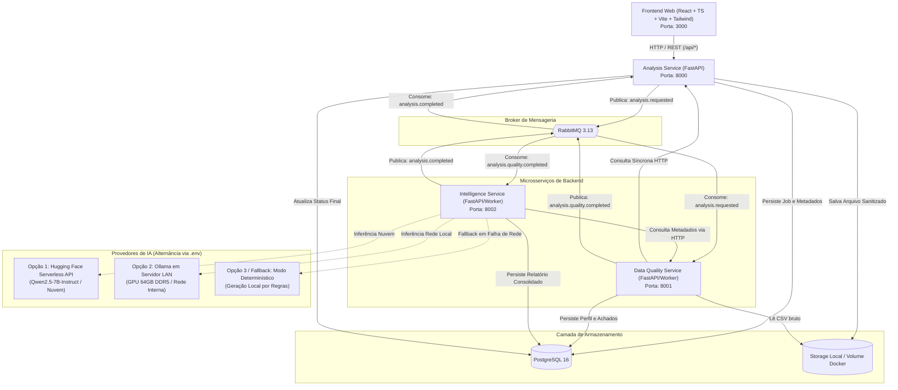
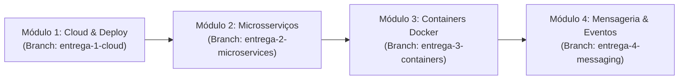

<div align="center">

# DataGuard

**Plataforma Distribuída de Análise e Qualidade de Dados Tabulares**

[](https://www.typescriptlang.org/)
[](https://react.dev/)
[](https://tailwindcss.com/)
[](https://www.python.org/)
[](https://fastapi.tiangolo.com/)
[](https://www.postgresql.org/)
[](https://www.rabbitmq.com/)
[](https://www.docker.com/)
[](https://huggingface.co/)
[](https://ollama.com/)
[]()

</div>

---

## Sumário

- [Visão Geral](#visão-geral)
- [Contexto Acadêmico e Alinhamento](#contexto-acadêmico-e-alinhamento)
- [Arquitetura do Sistema](#arquitetura-do-sistema)
- [Camada de Interface (Frontend Desacoplado)](#camada-de-interface-frontend-desacoplado)
- [Microsserviços de Backend](#microsserviços-de-backend)
- [Camada de Inteligência Artificial Híbrida](#camada-de-inteligência-artificial-híbrida)
- [Mapeamento dos Módulos da Disciplina](#mapeamento-dos-módulos-da-disciplina)
- [Tecnologias Utilizadas](#tecnologias-utilizadas)
- [Estrutura do Repositório](#estrutura-do-repositório)
- [Instalação e Execução](#instalação-e-execução)
- [Variáveis de Ambiente e Alternância de Provedores](#variáveis-de-ambiente-e-alternância-de-provedores)
- [Documentação Complementar](#documentação-complementar)

---

## Visão Geral

O **DataGuard** é uma plataforma distribuída voltada para inspeção automatizada, perfilamento e validação de qualidade de dados em arquivos tabulares (iniciando em CSV).

O sistema resolve a fricção manual na auditoria de dados: ao receber um conjunto de dados, processa métricas estatísticas determinísticas (valores nulos, discrepâncias de tipos, duplicatas, distribuições e anomalias numéricas), consolida achados com evidências rastreáveis e disponibiliza um relatório técnico enriquecido com insights explicativos gerados por inteligência artificial (com suporte híbrido a Hugging Face Serverless ou servidor local Ollama com aceleração por GPU via rede interna).

### Princípios Norteadores

- **Cálculo Determinístico Obrigatório:** Estatísticas, contagens, métricas e detecções são processadas via código (Pandas/NumPy) e nunca delegadas a modelos probabilísticos.
- **IA como Camada Explicativa e Híbrida:** Modelos de linguagem atuam exclusivamente na síntese contextual, interpretação técnica e redação de resumos executivos, podendo ser executados na nuvem ou em servidor com GPU local na rede do laboratório.
- **Desacoplamento Completo Frontend / Backend:** Interface web moderna em Single-Page Application (SPA) comunicando-se exclusivamente via API pública REST.
- **Rastreabilidade e Evidência:** Todo apontamento crítico no relatório final referencia diretamente a coluna, o valor métrico e a regra violada.

---

## Contexto Acadêmico e Alinhamento

O DataGuard é desenvolvido como projeto prático da disciplina de **Sistemas Distribuídos** da **Universidade do Estado do Rio Grande do Norte (UERN)**.
O projeto contempla os quatro eixos da ementa prática da disciplina:

1. **Computação em Nuvem:** Publicação de serviço base, banco de dados gerenciado e exposição de endpoints REST públicos.
2. **Microsserviços:** Decomposição do sistema em múltiplos serviços com responsabilidades delimitadas e comunicação síncrona via rede (HTTP/REST).
3. **Containers:** Isolamento de processos, conteinerização individual com Dockerfiles enxutos e orquestração de ambiente por Docker Compose com persistência de volumes.
4. **Mensageria e Streaming:** Processamento assíncrono distribuído através de broker de mensagens (RabbitMQ) e análise conceitual de arquiteturas orientadas a streaming de eventos (Apache Kafka / Redpanda).

---

## Arquitetura do Sistema

A solução adota o modelo de arquitetura orientada a serviços com suporte a processamento assíncrono baseado em eventos.



---

## Camada de Interface (Frontend Desacoplado)

A interface de usuário do DataGuard é construída como uma aplicação web desacoplada dos microsserviços de backend:

- **Stack Técnica:** React 18/19, TypeScript, Vite e Tailwind CSS.
- **Isolamento Arquitetural:** O frontend reside na pasta `/frontend` e funciona como um cliente HTTP independente, consumindo apenas as rotas públicas do `analysis-service`. Ele nunca interage diretamente com o banco de dados, com o RabbitMQ ou com os serviços analíticos internos.
- **Funcionalidades da Interface:**
  - Área de upload de CSV com drag-and-drop e validações preliminares de extensão e tamanho máximo.
  - Acompanhamento em tempo real do estado de processamento (`enviada` -> `validando` -> `analisando` -> `gerando_relatorio` -> `concluida`).
  - Painel analítico com visualizações e gráficos estatísticos (distribuição de tipos, percentual de nulos por coluna e cardinalidade).
  - Tabela técnica de achados com filtragem por severidade e visualização das evidências.
  - Painel de relatório executivo indicando a origem dos insights gerados (`rules_only` ou `llm_assisted`).
  - Histórico de análises realizadas com consulta sob demanda.

---

## Microsserviços de Backend

<div align="center">

| Microsserviço | Papel no Domínio | Protocolos | Tecnologias Chave |
| :--- | :--- | :--- | :--- |
| **Analysis Service** | Ponto de entrada, recepção de uploads, orquestrador de status e controle da entidade central `AnalysisJob`. | HTTP REST (Público), AMQP (Consumer/Publisher) | FastAPI, Pydantic, SQLAlchemy |
| **Data Quality Service** | Motor de processamento analítico: parsing de CSV, perfilamento estatístico e identificação de violações de dados. | AMQP (Consumer/Publisher), HTTP REST (Interno) | FastAPI, Pandas, NumPy, Pydantic |
| **Intelligence Service** | Agregador de relatórios: estruturação dos achados técnicos e geração de sínteses explicativas com LLM Híbrido. | AMQP (Consumer/Publisher), HTTP REST (Interno) | FastAPI, Hugging Face Hub, Ollama API, Pydantic |

</div>

---

## Camada de Inteligência Artificial Híbrida

O DataGuard conta com uma arquitetura flexível e resiliente para execução de modelos de linguagem, permitindo alternar facilmente entre duas soluções gratuitas e sem custo de nuvem:

### 1. Provedor Nuvem: Hugging Face Serverless Inference API

- **Ideal para:** Desenvolvimento geral, demonstrações em qualquer lugar e execução sem dependência de hardware local.
- **Modelo Homologado:** `Qwen/Qwen2.5-7B-Instruct`.
- **Ativação:** Definir `LLM_PROVIDER=huggingface` e fornecer o token gratuito em `HF_TOKEN`.

### 2. Provedor Rede Local: Ollama com Servidor Dedicado de GPU

- **Ideal para:** Testes na rede do laboratório da UERN, aproveitando uma máquina de alto desempenho equipada com RTX 3060 12GB e 64GB de RAM DDR5.
- **Modelo Homologado:** `qwen2.5:7b` (ou `llama3.2:3b`).
- **Ativação:** Definir `LLM_PROVIDER=ollama` e apontar `OLLAMA_BASE_URL` para o endereço IP do servidor na rede local (ex.: `http://192.168.1.100:11434`).
- **Vantagens:** Baixa latência, zero limite de tokens por minuto (sem rate limiting) e total privacidade dos dados dentro da rede local.

### 3. Mecanismo de Fallback Automático e Resiliência

Se o servidor Ollama estiver inacessível (ex.: desenvolvedor fora da universidade), se a API da Hugging Face retornar 429/503, ou se `LLM_ENABLED=false`, o sistema automaticamente reverte para a geração determinística baseada em regras (`rules_only`). A esteira de processamento nunca é interrompida.

---

## Mapeamento dos Módulos da Disciplina

Para atender rigorosamente ao cronograma, o projeto é versionado com tags e branches específicas para cada entrega:



### Módulo 1: Computação em Nuvem

- **Entregável:** API base (`Analysis Service`) publicada em nuvem com banco de dados remoto gerenciado (PostgreSQL via Render/Neon/Supabase).
- **Entidade Central:** CRUD completo e ciclo de vida do recurso `AnalysisJob`.
- **Artefatos:** Roteiro de testes documentado (`curl` / Postman) e vídeo demonstrativo da aplicação respondendo publicamente.

---

## Tecnologias Utilizadas

<div align="center">

| Categoria | Tecnologia | Justificativa Técnica |
| :--- | :--- | :--- |
| **Frontend Web** | React 18/19, TypeScript, Vite, Tailwind CSS | Interface desacoplada, performática, com tipagem estática e estilização utilitária sóbria. |
| **Backend Framework** | Python 3.11+ & FastAPI | Arquitetura assíncrona (ASGI), validação rigorosa com Pydantic v2 e documentação OpenAPI nativa. |
| **Manipulação de Dados** | Pandas & NumPy | Operações matriciais vetorizadas e eficientes para perfilamento estatístico descritivo. |
| **Persistência de Dados** | PostgreSQL 16 | Banco relacional robusto com suporte nativo a tipos estruturados e campos JSONB. |
| **Mensageria** | RabbitMQ 3.13 | Broker confiável baseado no protocolo AMQP com suporte nativo a confirmações (ACK), DLQ e roteamento avançado. |
| **Orquestração** | Docker & Compose | Padronização e reprodutibilidade do ambiente local e de homologação. |
| **IA em Nuvem** | Hugging Face Serverless API | Inferência gratuita em nuvem via modelos abertos como Qwen2.5-7B sem necessidade de GPU no host local. |
| **IA em Rede Local (LAN)** | Ollama | Servidor de inferência local de altíssima performance conectado via rede à máquina com GPU dedicada. |
| **Testes e Qualidade** | Pytest, HTTPX, Ruff | Cobertura de testes unitários/integração e padronização estrita de código. |

</div>

---

## Estrutura do Repositório

```text
data-guard/
├── README.md                           # Visão geral, setup e guia de avaliação
├── AGENTS.md                           # Diretrizes técnicas para agentes de IA e devs
├── docker-compose.yml                  # Orquestração do ambiente completo
├── .env.example                        # Modelo de configuração de variáveis de ambiente
├── .gitignore                          # Regras de exclusão de arquivos e diretórios
│
├── docs/                               # Documentação técnica e acadêmica
│   └── ARQUITETURA.md                  # Especificação profunda da arquitetura distribuída
│
├── frontend/                           # Aplicação Web SPA desacoplada
│   ├── Dockerfile                      # Multi-stage build (Vite -> Nginx)
│   ├── package.json
│   ├── vite.config.ts
│   ├── tsconfig.json
│   └── src/
│       ├── api/                        # Cliente de integração com o analysis-service
│       ├── components/                 # Componentes visuais reutilizáveis
│       ├── features/                   # Módulos de tela (upload, status, relatório)
│       ├── hooks/                      # Custom hooks para polling e requisições
│       └── types/                      # Interfaces TypeScript compartilhadas
│
├── services/                           # Microsserviços desacoplados de backend
│   ├── analysis-service/               # Orquestrador de jobs, uploads e API pública
│   │   ├── Dockerfile
│   │   ├── pyproject.toml
│   │   ├── app/
│   │   └── tests/
│   │
│   ├── data-quality-service/           # Perfilamento, métricas e detecção de anomalias
│   │   ├── Dockerfile
│   │   ├── pyproject.toml
│   │   ├── app/
│   │   └── tests/
│   │
│   └── intelligence-service/           # Relatórios e inferência híbrida (HF / Local)
│       ├── Dockerfile
│       ├── pyproject.toml
│       ├── app/
│       └── tests/
│
├── infra/                              # Configurações de infraestrutura
│   ├── postgres/                       # Scripts de inicialização do banco
│   └── rabbitmq/                       # Definições de exchanges, filas e permissões
│
└── storage/                            # Volume local compartilhado para arquivos temporários
```

---

## Instalação e Execução

### Pré-requisitos

- Docker Engine 24.0+ e Docker Compose v2+
- Python 3.11+ e Node.js 20+ (para execução local fora de containers)
- Git instalado

### Execução com Docker Compose

1. Clone o repositório e navegue até a raiz do projeto:

   ```bash
   git clone https://github.com/usuario/data-guard.git
   cd data-guard
   ```

2. Crie o arquivo de variáveis de ambiente a partir do exemplo:

   ```bash
   cp .env.example .env
   ```

3. Inicialize a interface, os serviços de backend, o banco e o broker:

   ```bash
   docker compose up --build -d
   ```

4. Verifique o status dos serviços em execução:

   ```bash
   docker compose ps
   ```

5. Acesse os pontos de extremidade da aplicação:
   - **Interface Web (Frontend):** [http://localhost:3000](http://localhost:3000)
   - **Analysis Service (API & Swagger):** [http://localhost:8000/docs](http://localhost:8000/docs)
   - **Data Quality Service:** [http://localhost:8001/docs](http://localhost:8001/docs)
   - **Intelligence Service:** [http://localhost:8002/docs](http://localhost:8002/docs)
   - **Painel Administrativo do RabbitMQ:** [http://localhost:15672](http://localhost:15672) (Credenciais: `guest` / `guest` em desenvolvimento local)

---

## Variáveis de Ambiente e Alternância de Provedores

O arquivo `.env` controla os parâmetros de execução e permite alternar instantaneamente o provedor de inteligência artificial:

### Cenário 1: Uso com Hugging Face (Nuvem / Sem GPU Local)

```dotenv
LLM_ENABLED=true
LLM_PROVIDER=huggingface
HF_TOKEN=hf_seuTokenAqui
HF_MODEL_ID=Qwen/Qwen2.5-7B-Instruct
```

### Cenário 2: Uso com Servidor Ollama na Rede Local (Universidade com GPU)

```dotenv
LLM_ENABLED=true
LLM_PROVIDER=ollama
OLLAMA_BASE_URL=http://192.168.1.100:11434
OLLAMA_MODEL=qwen2.5:7b
```

### Cenário 3: Modo 100% Determinístico (Sem IA / Avaliação Offline)

```dotenv
LLM_ENABLED=false
```

> [!IMPORTANT]
> Caso o provedor configurado no `.env` esteja inacessível por falha de conexão na rede, o `intelligence-service` reverte automaticamente para o Modo Determinístico, assegurando que o relatório seja sempre entregue.

---

## Documentação Complementar

- **[Especificação de Arquitetura Técnica](docs/ARQUITETURA.md):** Detalhamento dos padrões distribuídos, contratos de mensagens, diagramas de sequência, topologia do frontend e modelagem de entidades.
- **[Diretrizes para Agentes e Desenvolvedores](AGENTS.md):** Manual de operação para agentes autônomos de código, fluxos de trabalho, regras de validação e Definição de Pronto (DoD).
