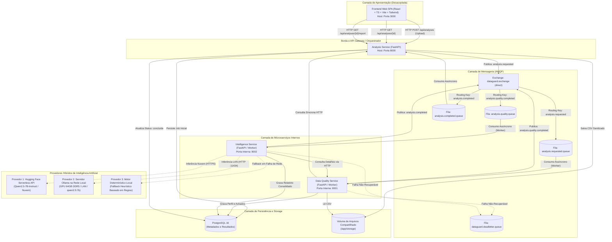
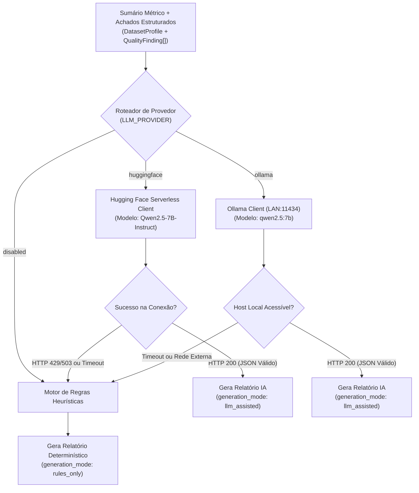
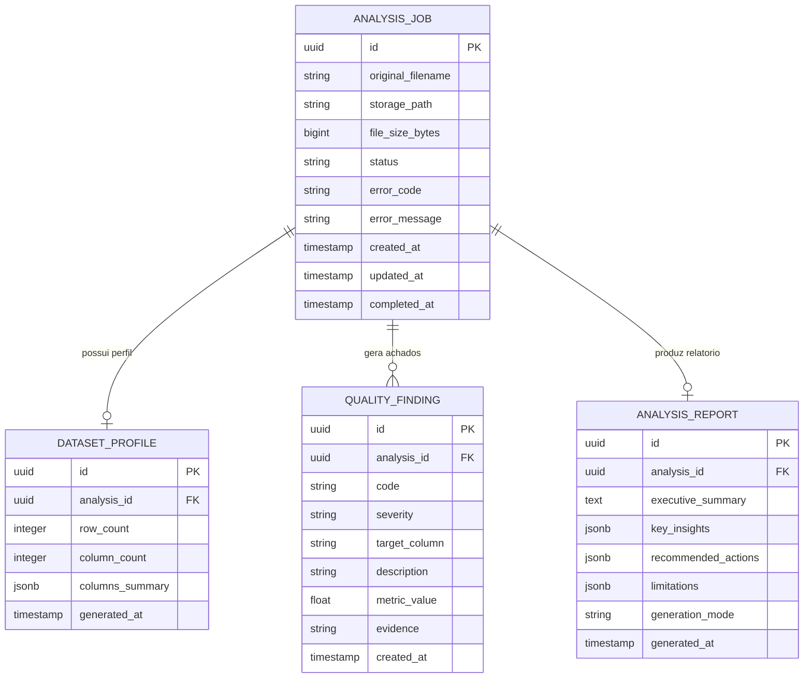
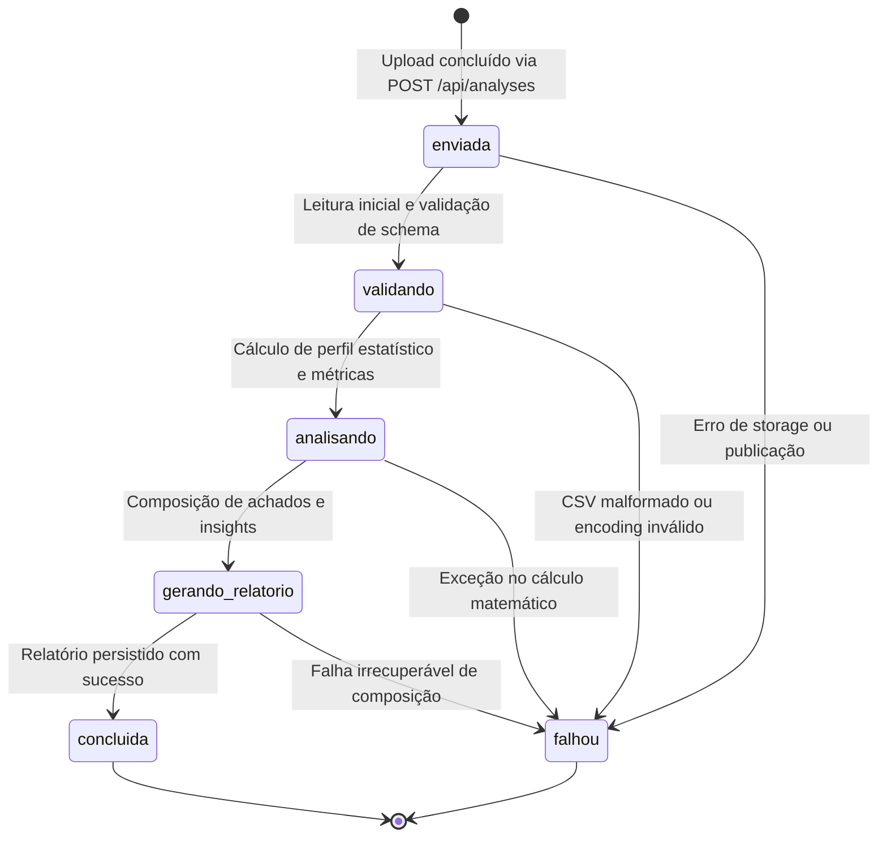
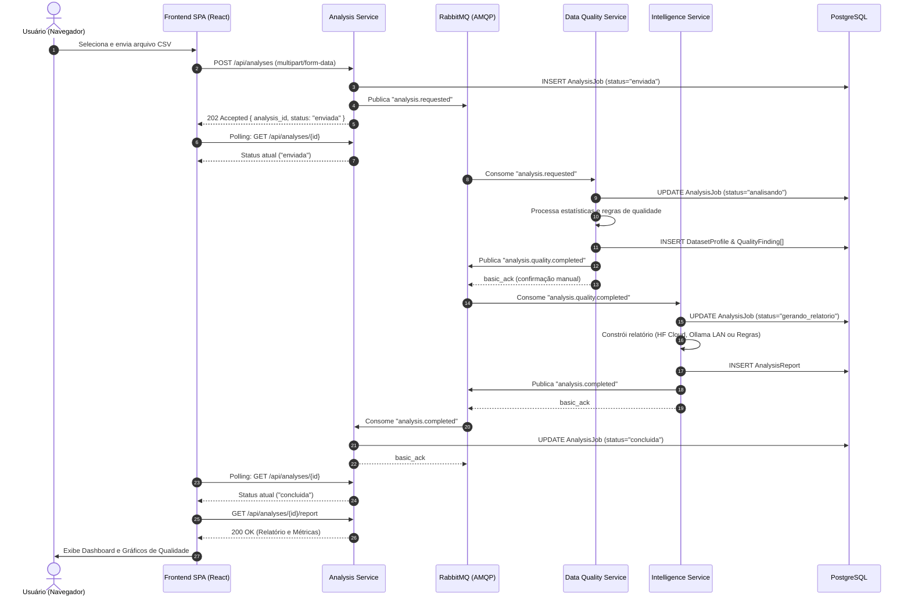

# Especificação da Arquitetura Distribuída — DataGuard

Este documento descreve formalmente a arquitetura de software, a modelagem de dados, a camada de apresentação desacoplada, os contratos de comunicação entre microsserviços, a integração híbrida de inteligência artificial e a fundamentação teórica de sistemas distribuídos aplicada ao projeto **DataGuard**.

---

## 1. Visão Arquitetural e Topologia do Sistema

O **DataGuard** adota uma arquitetura orientada a serviços (SOA / Microsserviços) distribuída, complementada por uma aplicação frontend desacoplada (SPA) e comunicação assíncrona orientada a eventos para o processamento intensivo de dados tabulares.

### 1.1 Diagrama de Topologia de Rede e Comunicação



---

## 2. Camada de Apresentação (Frontend Desacoplado)

A aplicação cliente é projetada como um sistema web totalmente independente dos serviços de backend, atendendo a boas práticas de separação entre interface e serviços de negócio.

### 2.1 Especificação Técnica do Frontend

- **Framework e Tooling:** React 18/19, TypeScript estrito, Vite (bundler otimizado para HMR e build de produção).
- **Estilização e Design System:** Tailwind CSS utilitário com paleta sóbria e corporativa (tons neutros, ardósia e azul técnico), **estritamente sem emojis**, utilizando ícones vetoriais padronizados (Lucide React).
- **Visualização de Dados:** Recharts para renderização declarativa e responsiva de:
  - Histogramas de distribuição de valores numéricos.
  - Gráficos de barras para percentual de valores nulos por coluna.
  - Gráficos de composição para cardinalidade de atributos categóricos.
- **Isolamento de Comunicação:** O frontend comunica-se exclusivamente com a API pública do `analysis-service` (`http://localhost:8000/api`). Em nenhum cenário o frontend acessa portas internas do banco de dados, broker RabbitMQ ou serviços de processamento.

### 2.2 Estrutura Modular da Aplicação Web

```text
frontend/
├── Dockerfile                  # Multi-stage build (Vite -> Nginx Alpine)
├── nginx.conf                  # Roteamento SPA e proxy reverso opcional
├── package.json
├── vite.config.ts
├── tsconfig.json
└── src/
    ├── api/                    # Clientes de comunicação HTTP (Axios / Fetch tipado)
    │   └── analysesApi.ts      # Métodos: createAnalysis, getStatus, getReport, listAnalyses
    ├── components/             # Componentes atômicos e de layout
    │   ├── ui/                 # Botões, Badges, Cards, Alertas e Modais
    │   └── layout/             # Header, Sidebar, Container e Footer
    ├── features/               # Módulos organizados por contexto de uso
    │   ├── upload/             # Área de upload com dropzone, feedback de tamanho e validação
    │   ├── status/             # Barra de progresso e máquina de estados visual
    │   ├── quality/            # Painel de métricas e tabelas de achados
    │   └── report/             # Visualizador do relatório consolidado e insights
    ├── hooks/                  # Custom hooks para polling e requisições assíncronas
    │   └── useAnalysisPolling.ts
    └── types/                  # Interfaces e tipos TypeScript sincronizados com os schemas Pydantic
        └── analysis.ts
```

---

## 3. Microsserviços de Backend e Delimitação de Contextos

### 3.1 Analysis Service

- **Contexto Delimitado:** Gerenciamento do ciclo de vida da entidade central `AnalysisJob`, recepção pública de requisições e exposição da API REST.
- **Responsabilidades:**
  - Validar tamanho, formato e integridade básica de arquivos CSV no endpoint `/api/analyses`.
  - Atribuir identificador único (UUID v4) e salvar o arquivo em diretório controlado com nome seguro e sanitizado.
  - Registrar metadados iniciais no PostgreSQL com status `enviada`.
  - Publicar o evento inicial `analysis.requested` no RabbitMQ.
  - Consumir eventos de conclusão ou falha para atualizar o status final do job.
  - Fornecer endpoints de consulta paginada de histórico e detalhes de relatório.

### 3.2 Data Quality Service

- **Contexto Delimitado:** Motor analítico e estatístico determinístico de dados tabulares.
- **Responsabilidades:**
  - Ler e decodificar o arquivo CSV referenciado no evento.
  - Inferir tipos de dados de cada coluna (numérico, categórico, temporal, textual).
  - Executar cálculos estatísticos descritivos por meio de algoritmos vetorizados (**Pandas** / **NumPy**):
    - Numéricos: Contagem válida, percentual de nulos, média, mediana, desvio padrão, mínimo, quartis e máximo.
    - Categóricos: Contagem de valores únicos, cardinalidade e frequência relativa das classes mais comuns.
    - Temporais: Intervalo de datas, menor/maior data e frequência.
  - Identificar violações de qualidade (achados): linhas duplicadas, ausência crítica de valores e colunas de tipo corrompido.
  - Persistir o perfil estruturado (`DatasetProfile`) e os achados (`QualityFinding`) no PostgreSQL.
  - Publicar o evento `analysis.quality.completed` com o resumo dos achados.

### 3.3 Intelligence Service

- **Contexto Delimitado:** Composição de relatórios executivos e camada de interpretação contextual.
- **Responsabilidades:**
  - Consumir os resultados consolidados pelo `Data Quality Service`.
  - Gerar a estrutura base do relatório (`AnalysisReport`).
  - Executar o motor de síntese através do padrão Provedor Abstrato:
    - **Hugging Face Serverless API:** Chamada remota na nuvem (sem custo e sem GPU no host).
    - **Ollama em Servidor LAN:** Chamada local de altíssimo desempenho em máquina dedicada na mesma rede (GPU com 64GB DDR5 e 2TB NVMe).
    - **Fallback Determinístico (`rules_only`):** Síntese automática por regras pré-programadas em caso de ausência de rede, rate-limit ou indisponibilidade de infraestrutura.
  - Persistir o relatório final e emitir o evento `analysis.completed`.

---

## 4. Camada de Inteligência Artificial Híbrida e Resiliente

Para conciliar a necessidade de testes em múltiplos ambientes (desenvolvimento individual fora do laboratório versus testes de alta performance na rede da universidade), a arquitetura adota um design híbrido desacoplado.



### 4.1 Provedor 1: Hugging Face Serverless Inference API (Nuvem)

- **Objetivo:** Prover inferência de IA sem custos e sem exigir hardware dedicado local, ideal para desenvolvimento remoto e demonstrações em nuvem.
- **Modelo:** `Qwen/Qwen2.5-7B-Instruct`.
- **Comunicação:** HTTPS com token de acesso pessoal (`HF_TOKEN`).
- **Tratamento de Exceções:** Timeout estrito de 15 segundos. Se a API estiver sob cold-start (503) ou rate-limit (429), o sistema reverte para o fallback determinístico sem propagar erro ao usuário.

### 4.2 Provedor 2: Servidor Ollama na Rede Local (LAN com GPU Dedicada)

- **Objetivo:** Aproveitar a infraestrutura de alto desempenho disponível na rede do laboratório/universidade (servidor com GPU dedicada, 64GB DDR5 e 2TB NVMe).
- **Modelo Homologado:** `qwen2.5:7b` (ou `llama3.2:3b`). Oferece altíssima velocidade de geração (tokens/segundo) com consumo de VRAM perfeitamente adequado ao hardware.
- **Configuração de Rede:**
  - O servidor na LAN executa o daemon do Ollama com `OLLAMA_HOST=0.0.0.0:11434`.
  - O DataGuard acessa o endpoint `http://<LAN_IP>:11434/v1/chat/completions` (compatível com a API padrão do OpenAI) ou `http://<LAN_IP>:11434/api/chat`.
- **Vantagens da Abordagem:** Zero latência de internet, ausência de limites de requisição por minuto e isolamento completo dos dados dentro do perímetro da rede local.
- **Resiliência:** Se a aplicação for executada fora da universidade (onde o IP da LAN não é alcançável), a tentativa de conexão sofre timeout controlado (25s) e o fallback determinístico é acionado imediatamente.

### 4.3 Alternância Desacoplada (Switch via Variáveis de Ambiente)

A troca entre os dois provedores ocorre sem qualquer alteração de código, unicamente ajustando o `.env`:

```dotenv
# Para usar Hugging Face:
LLM_PROVIDER=huggingface
HF_TOKEN=hf_xxx
HF_MODEL_ID=Qwen/Qwen2.5-7B-Instruct

# Para alternar para a máquina da universidade:
LLM_PROVIDER=ollama
OLLAMA_BASE_URL=http://192.168.1.100:11434
OLLAMA_MODEL=qwen2.5:7b
```

---

## 5. Modelo de Domínio e Persistência de Dados

O banco de dados relacional (PostgreSQL 16) mantém a consistência transacional e o histórico das análises.



### 5.1 Máquina de Estados da Entidade Central (`AnalysisJob`)



---

## 6. Padrões de Comunicação em Sistemas Distribuídos

### 6.1 Comunicação Síncrona via HTTP/REST (Módulo 2)

Utilizada para consultas pontuais de leitura e sincronização de dados entre os microsserviços:

- O `Data Quality Service` expõe um endpoint interno `GET /internal/quality/{analysis_id}` que permite ao `Intelligence Service` inspecionar detalhes sob demanda.
- O `Analysis Service` expõe `GET /internal/jobs/{analysis_id}` para validação de vigência do job antes do início do processamento.
- **Tolerância a Falhas:** Timeout de cliente de 5.0 segundos com `httpx.AsyncClient` e respostas amigáveis de erro com códigos HTTP padronizados (`503 Service Unavailable`).

### 6.2 Comunicação Assíncrona via Mensageria com RabbitMQ (Módulo 4)

Utilizada para o pipeline principal de processamento de dados, desacoplando o recebimento da requisição do processamento numérico e de IA.



### 6.3 Garantias de Entrega e Confiabilidade

- **Confirmação Manual de Mensagens (ACK):** O consumidor apenas envia o `basic_ack` após a persistência segura do resultado no banco de dados.
- **Idempotência:** Cada consumidor verifica se o `analysis_id` já foi processado ou se o job já se encontra em estado avançado, descartando mensagens duplicadas provenientes de retentativas de rede.
- **Dead Letter Queue (DLQ):** Mensagens com dados permanentemente corrompidos ou que ultrapassarem 3 tentativas de re-enfileiramento são rejeitadas com `basic_nack(requeue=False)` e direcionadas automaticamente para a fila `dataguard.deadletter.queue`.

---

## 7. Estudo Comparativo: Mensageria (RabbitMQ) vs Streaming de Eventos (Kafka/Redpanda)

Para atender formalmente ao requisito teórico e projetual do **Módulo 4** da disciplina, estabelece-se a análise técnica e o dimensionamento comparativo entre as duas tecnologias.

```mermaid
flowchart TD
    subgraph Mensageria["Abordagem por Mensageria Tradicional (RabbitMQ - Implementado)"]
        P1["Produtor (Analysis Service)"] -->|Publica| EX["Exchange"]
        EX -->|Roteia| Q1["Fila de Tarefas"]
        Q1 -->|Entrega e Remove após ACK| C1["Consumidor (Data Quality)"]
    end

    subgraph Streaming["Abordagem por Streaming de Eventos (Apache Kafka / Redpanda - Projeção Teórica)"]
        P2["Produtor (Analysis Service)"] -->|Append-Only| TOPIC["Tópico Particionado: 'data-events'"]
        TOPIC -->|Offset 0, 1, 2... (Log Persistente)| TOPIC
        TOPIC -->|Leitura por Offset sem Remoção| CG1["Consumer Group: Data Quality"]
        TOPIC -->|Replay / Leitura Independente| CG2["Consumer Group: Auditoria & Analytics"]
    end
```

<div align="center">

| Critério Arquitetural | RabbitMQ (Implementação Atual) | Apache Kafka / Redpanda (Cenário de Streaming) |
| :--- | :--- | :--- |
| **Paradigma Central** | **Broker de Mensagens Inteligente:** Focado em filas de trabalho, roteamento flexível e entrega pontual. | **Log Distribuído Gravado em Disco:** Focado em retenção durável, sequencial e imutável de eventos ordenados. |
| **Ciclo de Vida do Dado** | Transiente: A mensagem é excluída da fila assim que o consumidor envia a confirmação (`basic_ack`). | Durável: Os eventos permanecem gravados no log de acordo com a política de retenção temporal ou volumétrica. |
| **Controle de Leitura** | Gerenciado pelo broker: o RabbitMQ monitora o envio e o ACK de cada mensagem. | Gerenciado pelo consumidor: cada grupo mantém seu próprio ponteiro de leitura (**offset**). |
| **Capacidade de Replay** | Baixa / Inexistente de forma nativa sem re-publicação explícita. | Alta: Permite reposicionar o offset no passado e reprocessar todo o histórico de eventos. |
| **Adequação ao DataGuard** | **Ideal para o escopo do projeto:** Distribuição de tarefas unitárias entre workers de backend com orquestração simples via Docker. | Justificável caso o DataGuard evoluísse para ingestão massiva de telemetria em tempo real ou auditoria contínua de streams. |

</div>

---

## 8. Estratégia de Conteinerização e Execução em Nuvem

### 8.1 Orquestração Completa com Docker Compose (Módulo 3)

O ambiente distribuído é executado através do comando `docker compose up --build`, instanciando:

- Aplicação Frontend (`frontend`) em container Node/Nginx servindo na porta `3000`.
- Três microsserviços de backend Python/FastAPI (`analysis-service:8000`, `data-quality-service:8001`, `intelligence-service:8002`).
- Um container de banco de dados (`postgres:16-alpine`) com volume persistente nomeado (`postgres_data`).
- Um container de broker de mensageria (`rabbitmq:3.13-management-alpine`) expondo a porta AMQP (`5672`) e a interface administrativa (`15672`).
- Um volume compartilhado (`storage_volume`) montado em `/app/storage` para trânsito dos arquivos CSV entre containers.

### 8.2 Implantação em Nuvem (Módulo 1)

- **Hospedagem da API:** Deploy do serviço `analysis-service` em plataforma com free tier (Render, Fly.io ou Railway).
- **Banco Remoto:** PostgreSQL gerenciado em nuvem (Neon DB ou Supabase).
- **Variáveis de Ambiente na Nuvem:** Todas as chaves e strings de conexão injetadas através do painel de controle do provedor, sem exposição de credenciais em repositório.
