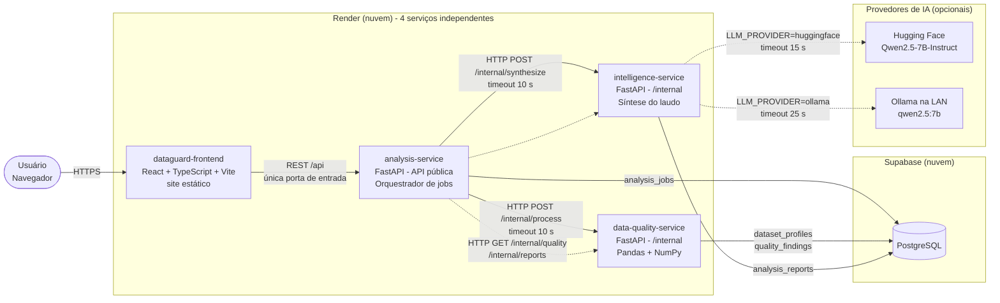
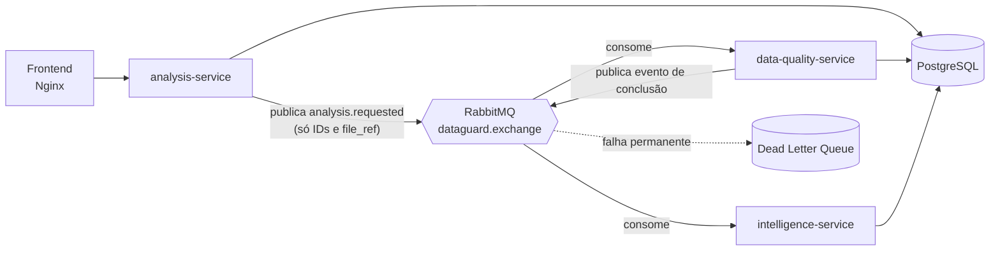
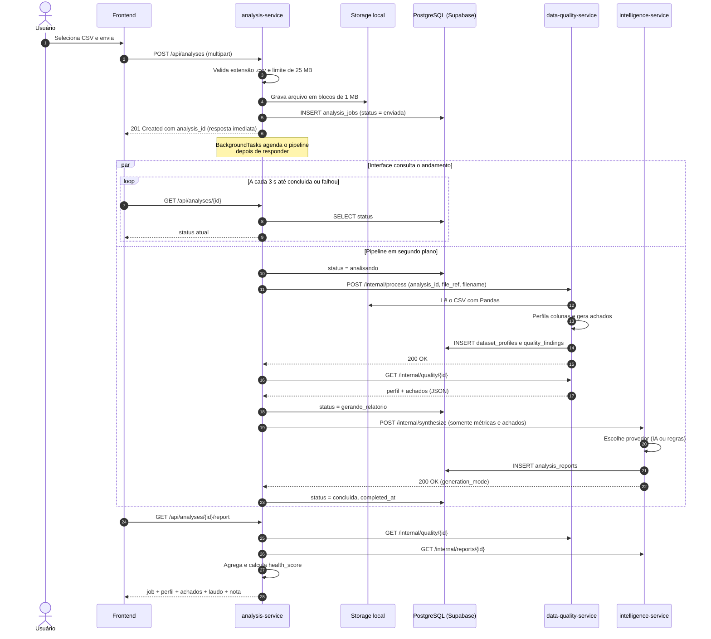
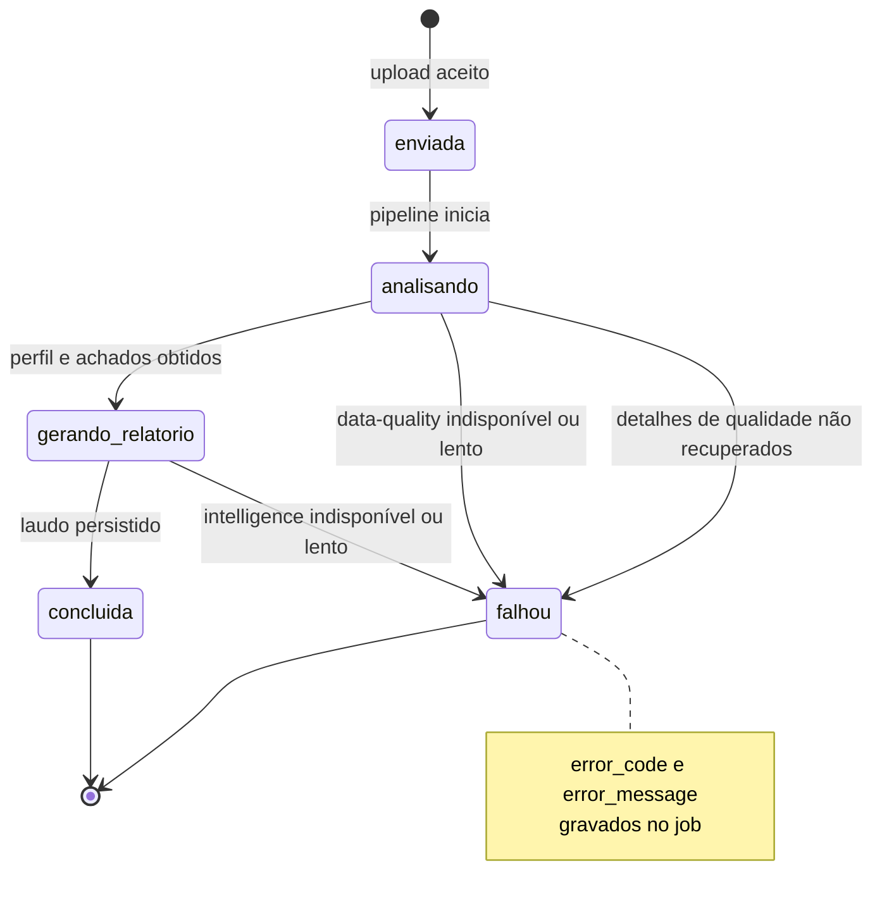
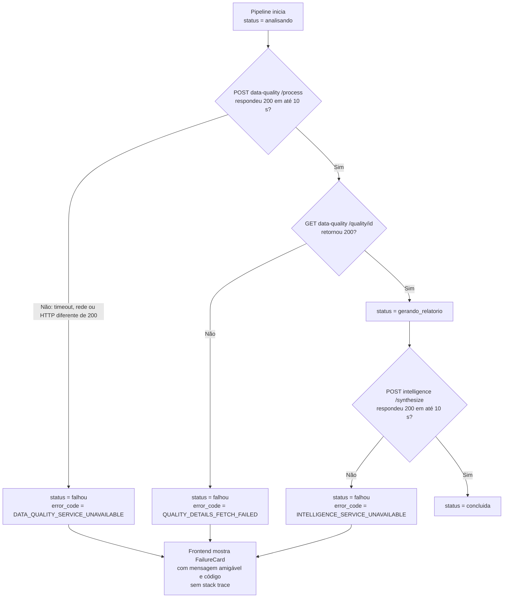
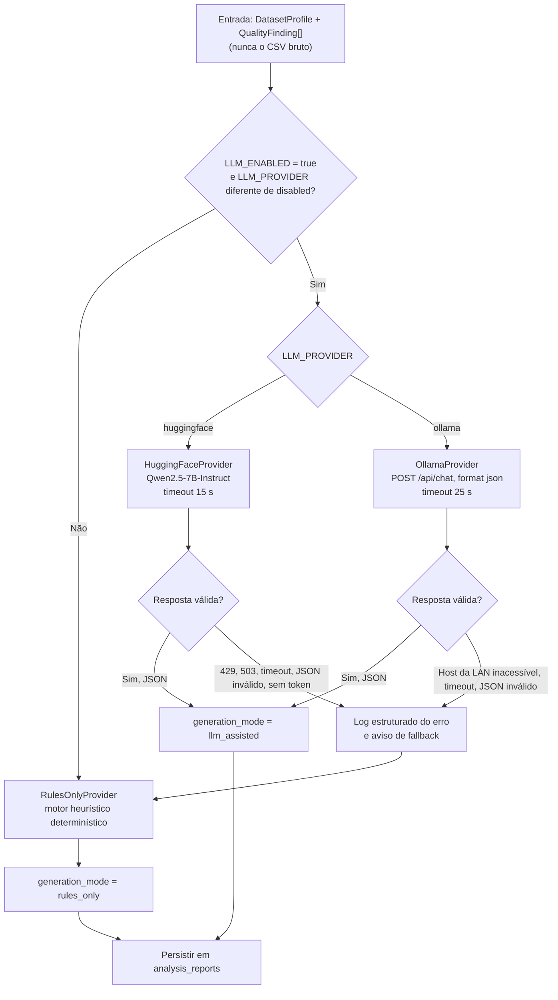
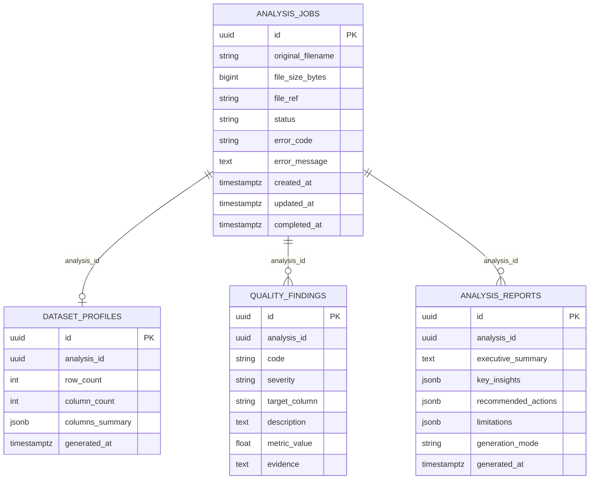

# Especificação da Arquitetura Distribuída — DataGuard

Este documento descreve formalmente a arquitetura de software, a modelagem de dados, a camada de apresentação desacoplada, os contratos de comunicação entre microsserviços, a integração híbrida de inteligência artificial, o tratamento de falhas e resiliência, e o plano de evolução distribuída do projeto **DataGuard**.

---

## 1. Visão Geral e Contexto de Execução

O **DataGuard** é uma plataforma distribuída para perfilamento determinístico e avaliação automatizada de qualidade em dados tabulares (arquivos CSV), enriquecida por uma camada de síntese técnica e contextualização executiva baseada em inteligência artificial híbrida.

### 1.1 Separação Rígida de Responsabilidades

O design do sistema apoia-se em quatro premissas fundamentais:

1. **Quem orquestra não processa:** O `analysis-service` gerencia o ciclo de vida dos jobs e atua como porta de entrada pública, sem realizar cálculos de métricas tabulares.
2. **Quem calcula é 100% determinístico:** O `data-quality-service` realiza o perfilamento estatístico e a detecção de anomalias exclusivamente por código vetorizado (**Pandas** e **NumPy**). O resultado é rigorosamente idempotente e reproduzível para o mesmo conjunto de dados.
3. **Quem sintetiza nunca vê os dados brutos:** O `intelligence-service` recebe unicamente o sumário métrico e os achados estruturados. O arquivo CSV bruto nunca trafega para o serviço de inteligência nem para provedores de IA externos.
4. **Isolamento da interface:** A camada de apresentação (`frontend`) comunica-se unicamente com a API pública do `analysis-service` via REST. Em nenhuma hipótese a interface conecta-se diretamente a bancos de dados, brokers de mensageria ou serviços internos.

---

## 2. Topologia do Sistema: Estado Atual (Módulo 2) vs Evolução Planejada (Módulos 3 e 4)

Para atender à evolução pedagógica e operacional da disciplina, o repositório mantém distinção clara entre a **implementação em produção atual** e o **plano de evolução arquitetural**.

### 2.1 Topologia Atual Implementada (Módulo 2)

Na fase atual, o sistema está completamente dividido em **quatro componentes autônomos**, hospedados no Render com persistência relacional remota no Supabase (PostgreSQL 16) e comunicação interna síncrona via HTTP:



### 2.2 Topologia Planejada com Mensageria e Contêineres (Módulos 3 e 4)

A arquitetura foi projetada para receber desacoplamento assíncrono via **RabbitMQ** e conteinerização integral via **Docker Compose** sem necessidade de reescrever as regras de negócio:



---

## 3. Delimitação de Responsabilidades dos Microsserviços

### 3.1 Analysis Service (Porta de Entrada e Orquestrador)

- **Porta pública:** Expõe rotas `/api/analyses` para o frontend.
- **Validações de entrada:** Verifica formato do arquivo (extensão `.csv`), sanitiza o nome e valida limite máximo de tamanho (padrão de 25 MB).
- **Processamento em streaming:** Salva o arquivo em blocos de 1 MB em disco local/storage para evitar estouro de memória no upload.
- **Resposta imediata:** Grava o job com status `enviada` e retorna HTTP 201 com o `analysis_id` em milissegundos.
- **Agendamento assíncrono:** Dispara o pipeline em segundo plano utilizando `BackgroundTasks` do FastAPI.
- **Agregação do relatório:** Quando a análise é concluída, unifica os dados das tabelas de métricas, achados e laudo, e calcula a nota global de saúde (**Health Score**).

### 3.2 Data Quality Service (Motor Analítico Determinístico)

- **Porta interna:** Expõe endpoints restritos `/internal/process` e `/internal/quality/{id}`.
- **Leitura do dataset:** Carrega o CSV apontado por `file_ref` (ou conteúdo serializado) utilizando Pandas.
- **Perfilamento estatístico:**
  - Colunas numéricas: contagem de válidos, taxa de nulos, média, mediana, desvio padrão, mínimo, quartis e máximo.
  - Colunas categóricas: cardinalidade (valores únicos) e frequência relativa das classes majoritárias.
  - Colunas temporais: menor e maior data, dispersão temporal.
- **Detecção de anomalias (Achados):** Identificação de linhas duplicadas, proporção crítica de nulos por coluna e incompatibilidade de tipos de dados.
- **Persistência especializada:** Grava o perfil estruturado na tabela `dataset_profiles` e os achados individuais na tabela `quality_findings`.

### 3.3 Intelligence Service (Motor de Síntese Técnica e Laudo)

- **Porta interna:** Expõe endpoints `/internal/synthesize` e `/internal/reports/{id}`.
- **Entrada estrita:** Recebe exclusivamente o sumário de colunas e a lista de `QualityFinding`.
- **Estratégia híbrida:** Aciona o provedor configurado (Hugging Face Serverless API, Ollama na rede local ou motor de regras local).
- **Saída padronizada:** Gera sumário executivo, interpretação contextual de cada achado, recomendações técnicas de saneamento e limitações observadas.
- **Persistência especializada:** Grava o laudo na tabela `analysis_reports`, sinalizando transparentemente o `generation_mode` utilizado (`llm_assisted` ou `rules_only`).

---

## 4. Ciclo de Vida e Passo a Passo de uma Análise

O diagrama de sequência a seguir ilustra a jornada completa de uma requisição de análise, desde o upload inicial pelo navegador até a renderização do painel consolidado:



---

## 5. Máquina de Estados da Análise (`AnalysisJob`)

Cada análise transita de forma estritamente controlada entre estados bem definidos. Os estados `concluida` e `falhou` são **terminais**: ao atingi-los, a interface web encerra automaticamente as consultas de polling.



---

## 6. Resiliência, Tratamento de Falhas e Códigos de Erro

Em uma arquitetura distribuída, falhas parciais de rede ou indisponibilidade de serviços dependentes devem ser tratadas com previsibilidade e elegância.

### 6.1 Fluxo de Falha nos Microsserviços e Timeouts

Todas as chamadas HTTP entre microsserviços utilizam timeout estrito de **10 segundos**. Caso um serviço não responda dentro do limite ou retorne erro HTTP, o coordenador cancela a operação imediatamente e atualiza o job no banco de dados com código de erro específico:



### 6.2 Catálogo de Códigos de Erro Padronizados

| Código de Erro (`error_code`) | Origem / Ponto de Falha | Mensagem Amigável Exibida na UI |
| :--- | :--- | :--- |
| `INVALID_FILE_FORMAT` | Validação no `analysis-service` | Formato de arquivo inválido. Apenas arquivos CSV (.csv) são aceitos. |
| `FILE_TOO_LARGE` | Validação de tamanho no upload | O arquivo excede o limite máximo permitido de 25MB. |
| `STORAGE_WRITE_ERROR` | Falha de disco/IO no upload | Não foi possível gravar o arquivo temporário no storage. |
| `DATA_QUALITY_SERVICE_UNAVAILABLE` | Chamada `POST /internal/process` | O motor determinístico de qualidade está temporariamente indisponível ou demorou a responder. |
| `QUALITY_DETAILS_FETCH_FAILED` | Chamada `GET /internal/quality/{id}` | Não foi possível recuperar os dados de qualidade processados. |
| `INTELLIGENCE_SERVICE_UNAVAILABLE` | Chamada `POST /internal/synthesize` | O serviço de inteligência e síntese técnica não pôde concluir o relatório. |

### 6.3 Estratégia de Fallback na Leitura de Relatórios

Ao consultar o endpoint `GET /api/analyses/{id}/report`:

1. O `analysis-service` tenta inicialmente buscar os dados mais recentes via HTTP nos microsserviços internos (`/internal/quality/{id}` e `/internal/reports/{id}`).
2. Caso um ou ambos os microsserviços estejam inalcançáveis no momento da leitura (ex.: serviço reiniciando ou pausado na nuvem), o orquestrador executa um **fallback automático de leitura direta nas tabelas do Supabase**.
3. Dessa forma, análises que já foram concluídas com sucesso no passado **nunca deixam de ser visualizadas** pelo usuário devido a indisponibilidades transitórias dos serviços auxiliares.

### 6.4 Inicialização Resiliente da Aplicação

Os serviços FastAPI contam com rotinas de inicialização seguras (`lifespan`): caso o banco de dados remoto esteja momentaneamente inalcançável durante a subida do container/processo, o serviço emite um log de aviso estruturado e não quebra a inicialização. Isso previne que a plataforma de hospedagem (Render) interprete o deploy como falho por falhas pontuais de conexão com o banco.

---

## 7. Camada de Inteligência Artificial Híbrida e Resiliente

O `intelligence-service` implementa o padrão de projeto **Provedor Abstrato** (*Strategy Pattern*), permitindo selecionar a infraestrutura de inferência via variáveis de ambiente com garantia de fallback determinístico incondicional.



### 7.1 Provedores Suportados

1. **Hugging Face Serverless API (Padrão em Nuvem):**
   - **Modelo:** `Qwen/Qwen2.5-7B-Instruct`.
   - **Comunicação:** HTTPS via API Serverless gratuita utilizando token de serviço (`HF_TOKEN`).
   - **Controle de Timeout:** 15 segundos.
   - **Tolerância a Falhas:** Captura status 429 (rate-limit) e 503 (cold start), acionando o fallback local sem quebrar o job.
2. **Ollama em Servidor LAN (GPU de Alta Performance):**
   - **Modelo:** `qwen2.5:7b` (ou `llama3.2:3b`).
   - **Cenário:** Execução em máquina local dedicada na rede do laboratório/universidade (servidor com GPU, 64GB DDR5 e 2TB NVMe).
   - **Comunicação:** `http://<LAN_IP>:11434/api/chat` com formato estruturado `"format": "json"`.
   - **Controle de Timeout:** 25 segundos.
   - **Resiliência a Desconexão:** Se o desenvolvedor ou o serviço estiver fora da rede interna, a falha de rota é capturada com log explícito e o fallback entra em ação.
3. **Motor Heurístico Determinístico (`rules_only`):**
   - Constrói o laudo técnico por meio de algoritmos baseados em regras codificadas em Python.
   - Execução instantânea (latência < 5 ms), sem dependência de chaves de API, GPU ou rede externa.

---

## 8. Cálculo Unificado do Health Score

Para prover um indicador claro e objetivo de conformidade do conjunto de dados, o `analysis-service` calcula uma nota global de 0 a 100 com base na quantidade e severidade dos achados determinísticos catalogados pelo `data-quality-service`:

$$\text{Health Score} = \max\left(0, \min\left(100, 100 - (15 \times N_{\text{critical}}) - (5 \times N_{\text{warning}}) - (1 \times N_{\text{info}})\right)\right)$$

- **Achados Críticos (`critical`):** Deduzem 15 pontos cada (ex.: taxas massivas de nulos em colunas-chave, anomalias estruturais severas).
- **Achados de Alerta (`warning`):** Deduzem 5 pontos cada (ex.: duplicações parciais, colunas com tipos potencialmente corrompidos).
- **Achados Informativos (`info`):** Deduzem 1 ponto cada (ex.: observações sobre cardinalidade ou formatações inconsistentes).
- **Classificação:**
  - **90 a 100:** Excelente integridade (Badge Verde).
  - **70 a 89:** Atenção recomendada (Badge Amarelo/Warn).
  - **Abaixo de 70:** Risco crítico de dados (Badge Vermelho/Danger).

---

## 9. Modelo Relacional e Persistência de Dados (Supabase)

O esquema relacional garante integridade referencial através do identificador unificado `analysis_id`:



---

## 10. Decisões de Projeto e Limitações Conhecidas

Como parte do rigor arquitetural do projeto, destacam-se decisões conscientes tomadas na fase atual (Módulo 2) e seus caminhos de mitigação:

1. **Orquestração Local em Memória vs Fila Distribuída:**
   - *Decisão Atual:* O `analysis-service` utiliza `BackgroundTasks` nativo do FastAPI para orquestrar a sequência de chamadas HTTP.
   - *Limitação:* Se o container do `analysis-service` for reiniciado durante o processamento, a tarefa em execução em memória será interrompida e o job poderá permanecer em estado intermediário.
   - *Mitigação Planejada:* Introdução do RabbitMQ no Módulo 4, com garantia de re-entrega de mensagens e persistência de tarefas em fila externa.
2. **Armazenamento de Arquivos em Disco Local:**
   - *Decisão Atual:* O CSV é gravado no sistema de arquivos local do serviço de análise e compartilhado via path (`file_ref`) ou transmitido via payload serializado.
   - *Limitação:* Em deploys com instâncias efêmeras isoladas em hosts físicos distintos, o caminho local deixa de ser acessível entre máquinas.
   - *Mitigação Planejada:* Uso de volumes persistentes compartilhados (`docker compose` no Módulo 3) ou buckets compatíveis com S3 (AWS/MinIO/Cloudflare R2) para produção multi-host.
3. **Compartilhamento de Banco de Dados:**
   - *Decisão Atual:* Os três microsserviços acessam o mesmo banco PostgreSQL no Supabase, cada qual atuando sobre suas respectivas tabelas.
   - *Vantagem:* Permitiu implementar o mecanismo de fallback de leitura de relatórios sem necessidade de barramentos complexos.
   - *Limitação:* Introduz acoplamento de persistência entre os serviços. A segregação completa de bancos pode ser realizada caso o volume de dados justifique partições independentes.

---

## 11. Comparativo Teórico: Mensageria (RabbitMQ) vs Streaming (Kafka/Redpanda)

Para fundamentação teórica de sistemas distribuídos e atendimento aos requisitos do Módulo 4:

```mermaid
flowchart TD
    subgraph Mensageria["Abordagem por Mensageria Tradicional (RabbitMQ - Planejado no Módulo 4)"]
        P1["Produtor (Analysis Service)"] -->|Publica| EX["Exchange: dataguard.exchange"]
        EX -->|Roteia| Q1["Fila de Tarefas: analysis.requested"]
        Q1 -->|Entrega e Remove após ACK| C1["Consumidor (Data Quality)"]
    end

    subgraph Streaming["Abordagem por Streaming de Eventos (Apache Kafka / Redpanda - Projeção Teórica)"]
        P2["Produtor (Analysis Service)"] -->|Append-Only| TOPIC["Tópico Particionado: 'data-events'"]
        TOPIC -->|Offset 0, 1, 2... (Log Persistente)| TOPIC
        TOPIC -->|Leitura por Offset sem Remoção| CG1["Consumer Group: Data Quality"]
        TOPIC -->|Replay / Leitura Independente| CG2["Consumer Group: Auditoria & Analytics"]
    end
```

<div align="center">

| Critério Arquitetural | RabbitMQ (Planejado para o DataGuard) | Apache Kafka / Redpanda (Streaming) |
| :--- | :--- | :--- |
| **Paradigma Central** | **Broker de Mensagens Inteligente:** Focado em filas de trabalho pontuais e roteamento flexível. | **Log Distribuído Gravado em Disco:** Focado em retenção durável e imutável de eventos ordenados. |
| **Ciclo de Vida do Dado** | Transiente: A mensagem é excluída da fila assim que o worker confirma o processamento (`basic_ack`). | Durável: Eventos permanecem gravados de acordo com a política de retenção em disco configurada. |
| **Controle de Leitura** | Gerenciado pelo broker: o RabbitMQ monitora o envio e a confirmação de cada mensagem. | Gerenciado pelo consumidor: cada grupo mantém seu próprio ponteiro de leitura (**offset**). |
| **Capacidade de Replay** | Baixa ou inexistente sem republicação explícita de mensagens. | Alta: Permite reposicionar o offset no passado e reprocessar eventos a qualquer momento. |
| **Adequação ao DataGuard** | **Ideal para o projeto:** Cada upload de arquivo CSV é uma tarefa unitária de processamento analítico discreto. | Superdimensionado para o escopo atual; seria justificável para ingestão massiva de telemetria contínua. |

</div>
