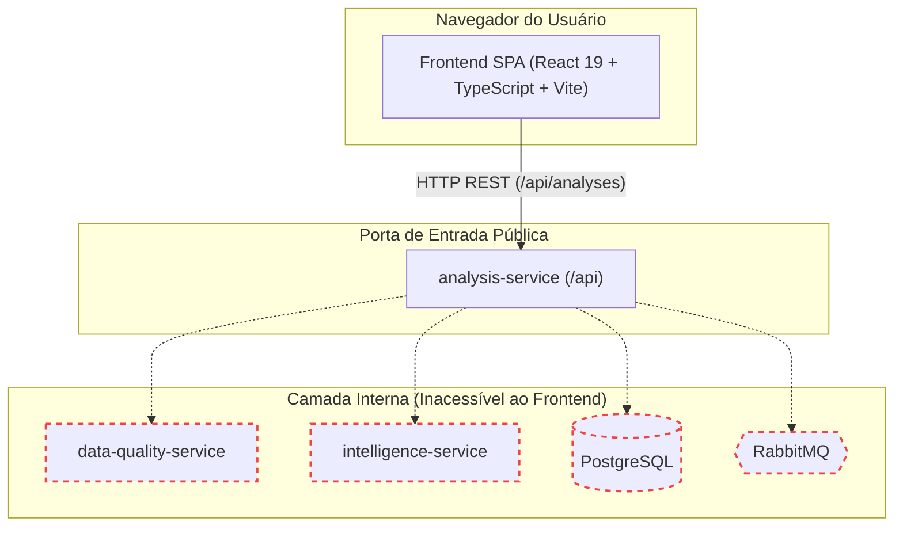
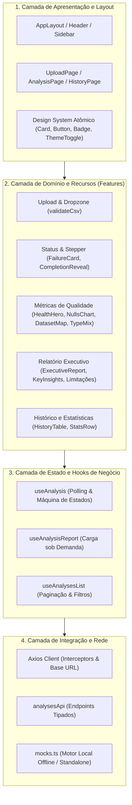
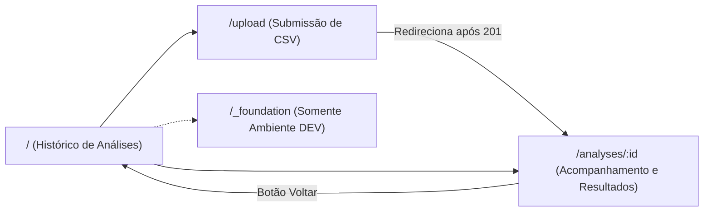
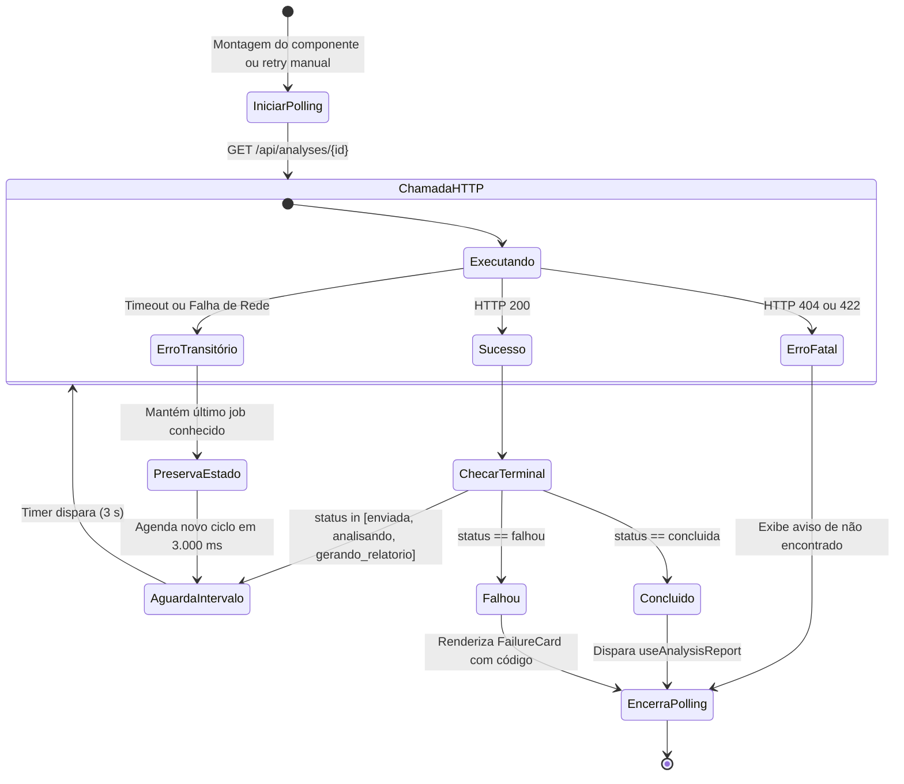
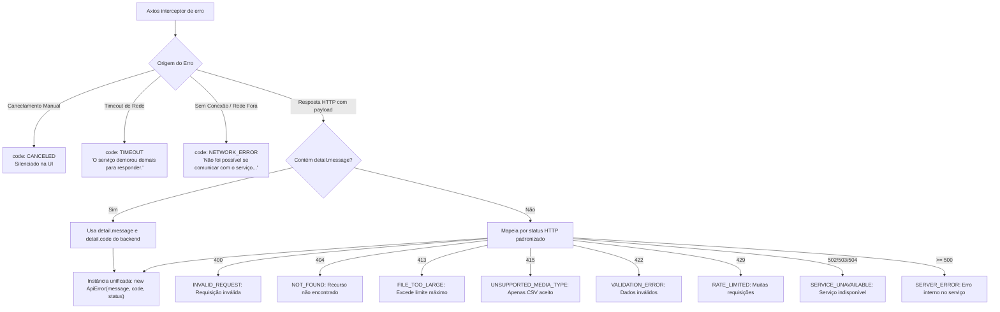
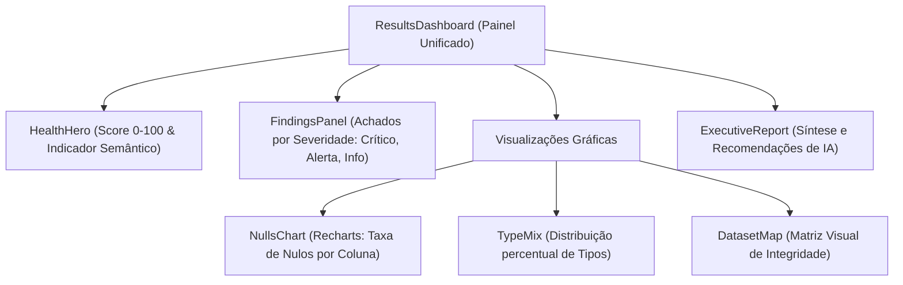

# Especificação da Arquitetura do Frontend — DataGuard

Este documento descreve formalmente a arquitetura da camada de apresentação (Frontend SPA) do **DataGuard**, seus padrões de design de interface, ciclo de vida de componentes, estratégia de consumo de APIs e tolerância a falhas, visualização de dados tabulares e diretrizes de usabilidade técnica corporativa.

---

## 1. Visão Geral e Propósito

O frontend do **DataGuard** é uma aplicação web Single-Page Application (SPA) moderna, desacoplada e estritamente tipada, desenvolvida com **React 19**, **TypeScript** e **Tailwind CSS v4**, construída e empacotada via **Vite**.

Sua responsabilidade exclusiva é fornecer uma interface de usuário analítica, fluida e de alta densidade informativa para submissão de conjuntos de dados CSV, acompanhamento em tempo real do pipeline distribuído de processamento e exploração interativa de métricas estatísticas, achados de qualidade e relatórios gerados por IA.



> [!IMPORTANT]
> **Isolamento Rígido de Rede:** O frontend comunica-se exclusivamente com a API pública do `analysis-service` (`/api`). Em nenhum cenário o frontend possui credenciais ou acessa diretamente o banco PostgreSQL, filas do RabbitMQ ou as portas dos microsserviços internos.

---

## 2. Princípios Arquiteturais e Diretrizes de Design

1. **Desacoplamento e Independência Operacional:** O frontend pode ser executado, testado e implantado de maneira autônoma (via servidor estático ou mock local), mantendo compatibilidade garantida por contratos de interface tipados.
2. **Experiência Assíncrona Não-Bloqueante:** O envio de arquivos pesados responde de forma imediata (retorno HTTP 201/202). A interface assume um modelo reativo de polling não-bloqueante a cada 3 segundos, permitindo ao usuário navegar livremente enquanto o pipeline executa em segundo plano.
3. **Resiliência a Oscilações de Conexão:** Quedas temporárias de conectividade entre o navegador e o backend não provocam quebras na interface ou resets de tela: o estado local é mantido e o polling retenta a requisição até alcançar um estado terminal (`concluida` ou `falhou`).
4. **Higiene e Proteção Visual contra Erros Crus:** O frontend **nunca** expõe stack traces de Python, mensagens de erro não tratadas ou queries de banco de dados. Qualquer exceção de backend é interceptada, normalizada pela classe `ApiError` e apresentada por meio de mensagens humanas e objetivas, com identificação semântica do código do erro (`error_code`).
5. **Identidade Visual Sóbria e Sem Emojis:** Design corporativo baseado em tons neutros, ardósia e azul técnico. A iconografia é 100% vetorial através de **Lucide React**, com **proibição estrita do uso de emojis** em títulos, badges ou alertas.
6. **Acessibilidade e Preferência de Movimento:** Suporte pleno a temas Claro e Escuro com transição suave via CSS variables (OKLCH), navegação acessível via teclado e respeito rigoroso à preferência `prefers-reduced-motion` para usuários sensíveis a animações.

---

## 3. Arquitetura em Camadas do Frontend

A aplicação é organizada segundo uma divisão modular e orientada a domínios de uso (*features*):



### 3.1 Estrutura do Diretório `frontend/src`

```text
frontend/src/
├── api/                        # Camada de comunicação de rede
│   ├── client.ts               # Instância do Axios, interceptors de erro e classe ApiError
│   ├── analysesApi.ts          # Métodos HTTP: listAnalyses, getAnalysis, createAnalysis, etc.
│   └── mocks.ts                # Simulador completo de backend para desenvolvimento e testes
│
├── components/                 # Componentes genéricos de UI e Layout
│   ├── brand/                  # Logotipo vetorial e cenários gráficos de fundo (Backdrop)
│   ├── layout/                 # AppLayout, Header, Sidebar, PageHeader, PagePlaceholder
│   └── ui/                     # Badge, Button, Card, CountUp, ProgressRing, ThemeToggle
│
├── features/                   # Módulos organizados por funcionalidade do usuário
│   ├── upload/                 # Dropzone, validação de extensão e limite de 25MB
│   ├── status/                 # AnalysisPage, StatusStepper (pipeline), FailureCard
│   ├── quality/                # HealthHero, NullsChart (Recharts), DatasetMap, TypeMix
│   ├── report/                 # ExecutiveReport (laudo técnico, insights, limitações)
│   ├── history/                # HistoryPage, HistoryTable paginada, StatsRow
│   └── foundation/             # Catálogo de componentes e tokens para validação em dev
│
├── hooks/                      # Custom hooks com ciclo de vida e concorrência
│   ├── useAnalysis.ts          # Polling a cada 3s com detecção de estados terminais
│   ├── useAnalysisReport.ts    # Carregamento sob demanda do laudo consolidado
│   └── useAnalysesList.ts      # Listagem reativa com paginação e cancelamento
│
├── lib/                        # Funções utilitárias puras
│   ├── format.ts               # Formatação de bytes, percentuais e datas (Intl)
│   ├── motion.ts               # Variantes de animação e curvas de transição Framer Motion
│   ├── quality.ts              # Regras de agrupamento de nulos e cores de visualização
│   ├── status.ts               # Metadados e rótulos de status em português
│   └── theme.ts                # Gerenciamento de tema (dark/light) com persistência local
│
└── types/                      # Contratos de tipos estritos TypeScript
    ├── analysis.ts             # Estrutura unificada de FullAnalysisDetails e JobStatus
    ├── job.ts                  # Schemas de AnalysisJob e parâmetros de paginação
    ├── quality.ts              # DatasetProfile, QualityFinding, ColumnSummary
    └── report.ts               # AnalysisReport, KeyInsight e RecommendedAction
```

---

## 4. Fluxo de Navegação e Máquina de Estados da Interface

### 4.1 Roteamento SPA

O frontend utiliza `react-router-dom` estruturado em layout mestre (`AppLayout`):



### 4.2 Ciclo de Vida do Polling no Hook `useAnalysis`

O hook `useAnalysis` gerencia a sincronização em segundo plano enquanto a análise é processada:



#### Características de Resiliência do Hook:
- **Intervalo Controlado:** Intervalo fixo de 3.000 ms definido em constante (`POLL_INTERVAL_MS = 3000`).
- **Estados Terminais:** Interrompe timers imediatamente ao receber `status = "concluida"` ou `status = "falhou"`.
- **Cancelamento Limpo:** Ao desmontar o componente ou navegar para outra tela, o `AbortController` cancela requisições em voo e limpa o timer (`window.clearTimeout`), impedindo memory leaks e atualizações de componentes desmontados.
- **Tolerância a Flutuações de Conexão:** Falhas transitórias não apagam o estado visual da tela; apenas registram o aviso e continuam tentando até que a conexão seja restabelecida.

---

## 5. Tratamento de Exceções e Normalização de Erros

Para garantir integridade de segurança e excelência de experiência do usuário, toda comunicação de rede passa por um interceptor de respostas do Axios que normaliza qualquer erro na classe `ApiError`:



### Componente Visual de Falha (`FailureCard`)
Quando a análise transita para o estado `falhou`, a tela exibe o componente `FailureCard`:
- **Estilo:** Borda semântica em tons de vermelho/perigo (`border-danger/25 bg-danger/[0.06]`), efeito backdrop-blur e gradiente sutil.
- **Ícone:** Vetor `OctagonAlert` do Lucide React.
- **Mensagem Amigável:** Texto explicativo em português voltado ao usuário final.
- **Badge Técnico de Erro:** Identificação monospaçada (`font-mono text-xs`) do código de erro (ex.: `DATA_QUALITY_SERVICE_UNAVAILABLE`, `INTELLIGENCE_SERVICE_UNAVAILABLE`), permitindo auditoria rápida sem poluir a visão do usuário com rastros de execução.

---

## 6. Módulos de Funcionalidade (Features)

### 6.1 Módulo de Upload (`features/upload`)
- **Componentes:** `UploadPage`, `Dropzone`, `validateCsv.ts`.
- **Validação Antecipada Client-Side:**
  - Verifica extensão do arquivo (estritamente `.csv`).
  - Checa teto máximo de 25 MB antes de consumir banda de envio.
  - Alerta caso o arquivo selecionado possua 0 bytes.
- **Submissão Segura:** Envia o arquivo como `multipart/form-data` sob a chave `file`. Ao obter resposta 201 com o `analysis_id`, redireciona imediatamente para `/analyses/:id`.

### 6.2 Módulo de Status e Stepper (`features/status`)
- **Componentes:** `AnalysisPage`, `StatusStepper`, `FailureCard`, `CompletionReveal`.
- **Linha do Tempo Visual (`StatusStepper`):** Apresenta as 4 etapas do pipeline (`Enviada` → `Analisando` → `Gerando Relatório` → `Concluída`), indicando qual serviço do backend está operando no momento.
- **Efeito de Revelação (`CompletionReveal`):** Transição de conclusão suave que transiciona o usuário do estado de espera para o painel consolidado de resultados sem recarregamento de página.

### 6.3 Módulo de Qualidade e Métricas Tabulares (`features/quality`)
Exibido automaticamente assim que o job atinge o status `concluida`:



- **HealthHero:** Renderiza o score de integridade (0 a 100) calculado pelo backend, com anel de progresso SVG animado e classificação em três faixas semânticas (Excelente, Atenção, Risco Crítico).
- **FindingsPanel:** Agrupa os achados determinísticos catalogados pelo `data-quality-service`. Permite alternar filtros por severidade (`critical`, `warning`, `info`) e exibe código do achado, coluna-alvo, descrição e evidência numérica.
- **NullsChart:** Gráfico de barras horizontal construído com **Recharts**, mapeando o percentual de dados faltantes de cada coluna com escala semântica:
  - `clean` (0% nulos): tom neutro / acento.
  - `low` (até 10% nulos): alerta suave.
  - `mid` (10% a 30% nulos): alerta intermediário (`warn`).
  - `high` (acima de 30% nulos): perigo crítico (`danger`).
- **DatasetMap:** Matriz de células em CSS Grid que oferece visão rápida e visual da integridade estrutural do conjunto de dados.
- **TypeMix:** Gráfico de barras de progresso composto indicando a proporção de tipos inferidos (Numérico, Categórico, Temporal e Textual).

### 6.4 Módulo de Relatório Executivo e Síntese de IA (`features/report`)
- **Componente:** `ExecutiveReport`.
- **Transparência de Geração:** Exibe com destaque o badge indicativo do modo de geração:
  - `llm_assisted`: gerado com auxílio de inteligência artificial (Qwen 2.5 na Hugging Face ou Ollama local).
  - `rules_only`: gerado deterministicamente por regras heurísticas locais em Python.
- **Conteúdo Estruturado:**
  - **Sumário Executivo:** Texto fluido sintetizando a condição geral do arquivo.
  - **Key Insights:** Lista de achados contextualizados com interpretações analíticas e ações sugeridas.
  - **Limitações do Estudo:** Advertências explícitas sobre escopo de inferência, tamanho amostral e restrições estatísticas.

### 6.5 Módulo de Histórico (`features/history`)
- **Componentes:** `HistoryPage`, `HistoryTable`, `StatsRow`.
- **Otimização de Métricas Globais (`StatsRow`):** Executa três consultas concorrentes de baixo overhead com `pageSize=1` (`total`, `concluida`, `falhou`) para obter os contadores agregados instantaneamente, sem necessitar transferir listas volumosas pela rede.
- **Tabela Paginada (`HistoryTable`):** Exibe histórico ordenado com nome do arquivo, tamanho legível, data de submissão, status com badge colorido e link direto para o relatório correspondente.

---

## 7. Sistema de Mocks e Modo Offline/Isolado

Para permitir testes de interface rápidos, demonstrações em ambientes sem internet ou desenvolvimento isolado do frontend, a aplicação conta com um sistema de simulação autônomo em `src/api/mocks.ts`.

- **Ativação:** Controlada pela variável de ambiente `VITE_USE_MOCKS=true`.
- **Comportamento Simulado:**
  - Reproduz o delay do upload real de arquivo.
  - Emite identificador UUID randômico e transita o status sequencialmente a cada ciclo de polling (`enviada` → `analisando` → `gerando_relatorio` → `concluida`).
  - Fornece conjuntos de dados sintéticos com métricas realistas, achados de qualidade e relatórios gerados por IA simulados.
  - Suporta teste visual de falhas com simulação de erros 413, 415 e falhas de serviço.

---

## 8. Design System e Tokens Visuais

O frontend emprega Tailwind CSS v4 diretamente via `@tailwindcss/vite`, com tokens padronizados em `src/index.css`:

### 8.1 Paleta de Cores e Tokens Semânticos
- **Superfície e Fundo:** `--color-bg-canvas`, `--color-bg-surface`, `--color-bg-elevated` adaptativos para temas claro e escuro.
- **Tipografia e Contraste:** `--color-fg-default`, `--color-fg-muted`, `--color-fg-subtle`.
- **Cores Semânticas de Estado:**
  - **Acento Técnico:** `--color-accent` (azul técnico profundo).
  - **Sucesso:** `--color-success` (esmeralda suave).
  - **Alerta / Atenção:** `--color-warn` (âmbar técnico).
  - **Perigo / Falha:** `--color-danger` (vermelho carmim).

### 8.2 Tipografia Técnica
- **Interface Geral:** Família `Inter Variable` para máxima legibilidade de rótulos, formulários e tabelas.
- **Identificadores e Métricas:** Família `JetBrains Mono Variable` para UUIDs, contagens numéricas, códigos de erro e valores de percentual.

---

## 9. Estratégia de Build, Otimização e Deploy

### 9.1 Build de Produção (Vite)
A compilação de produção executa checagem de tipos rigorosa antes da geração dos bundles:
```bash
npm run build   # tsc --noEmit && vite build
```
- **Code Splitting Automático:** Separação dos módulos de rotas e bibliotecas pesadas (como Recharts e Framer Motion).
- **Assets Hash:** Nomes de arquivos gerados com hashes criptográficos para garantia de invalidação de cache em navegadores.

### 9.2 Implantação Atual e Próximos Passos
- **Deploy Atual (Módulo 2):** Hospedado como **Static Site** no **Render**, servido via CDN global rápida com redirecionamento de rotas SPA (`/*` direcionado para `/index.html`).
- **Deploy Conteinerizado (Módulo 3):** O frontend será empacotado em uma imagem Docker multi-stage:
  - *Estágio 1 (Builder):* Imagem `node:22-alpine` para instalação enxuta de dependências e execução do comando `vite build`.
  - *Estágio 2 (Runtime):* Imagem `nginx:alpine` extremamente leve contendo unicamente os arquivos estáticos compilados em `/usr/share/nginx/html` e configuração otimizada de proxy reverso e gzip.
