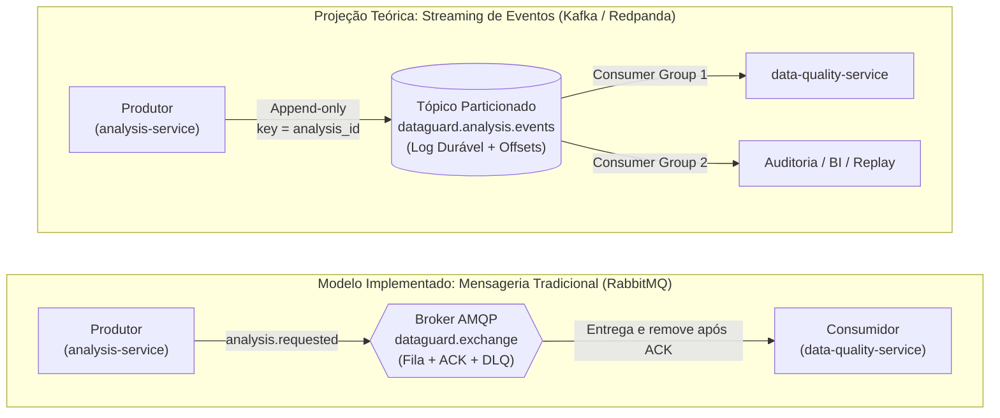
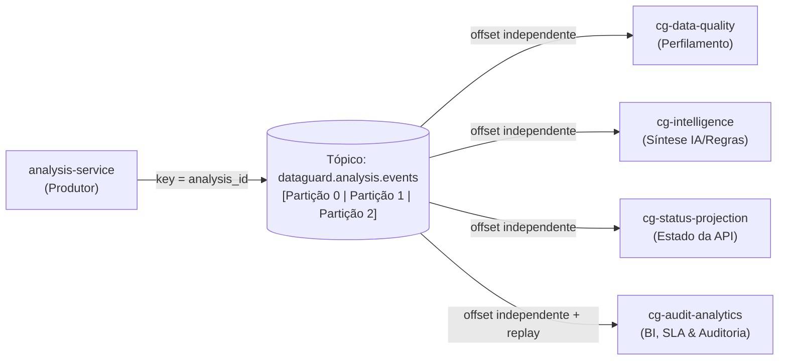

# Estudo Comparativo: Mensageria (RabbitMQ) vs. Streaming de Eventos (Apache Kafka / Redpanda)

Este documento apresenta a análise conceitual e arquitetural exigida no **Módulo 4 (Mensageria e Streaming de Eventos)** da disciplina de **Sistemas Distribuídos (UERN)**, contrastando a implementação atual do **DataGuard** com **RabbitMQ** frente a uma modelagem alternativa baseada em **Streaming de Eventos (Apache Kafka / Redpanda)**.

---

## 1. Visão Comparativa dos Paradigmas

---

## 2. Comparação Técnica Aplicada ao DataGuard

| Dimensão Arquitetural | RabbitMQ (Implementado no DataGuard) | Apache Kafka / Redpanda (Projeção em Streaming) |
| :--- | :--- | :--- |
| **Paradigma central** | **Smart Broker / Dumb Consumer:** o broker gerencia roteamento complexo (exchanges `topic`/`direct`), filas individuais, entregas e confirmações. | **Dumb Broker / Smart Consumer:** o broker mantém um log distribuído *append-only* particionado em disco; cada consumidor controla seu próprio ponteiro (**offset**). |
| **Retenção da mensagem** | **Transiente por consumo:** após o `basic_ack` do worker, a mensagem é removida da fila. | **Durável por política de retenção:** eventos permanecem armazenados por tempo (ex.: 7 dias) ou tamanho, mesmo depois de lidos por vários consumidores. |
| **Capacidade de Replay** | Baixa/inexistente nativamente: para reprocessar, o produtor precisa republicar o evento. | Alta e nativa: basta reposicionar o offset de um *consumer group* para reprocessar todo o histórico de análises. |
| **Roteamento e DLQ** | Nativo via `dataguard.exchange` (`topic`) e `dataguard.dlx` (`direct`), isolando automaticamente mensagens rejeitadas com `nack(requeue=False)` em DLQs por serviço. | Roteamento simples por tópico/partição; DLQ precisa ser implementada explicitamente pela aplicação publicando em um tópico separado (ex.: `*.dlq`). |
| **Ordenação** | Garantida dentro de uma fila com consumidor único, mas pode perder ordem em múltiplos workers concorrentes ou retries. | Ordenação estrita garantida **por partição**: usando `analysis_id` como chave de particionamento, todos os eventos de uma mesma análise preservam ordem causal absoluta. |
| **Escala de throughput** | Excelente para dezenas de milhares de tarefas discretas/s com baixa latência e controle fino de `prefetch_count`. | Projetado para milhões de eventos/s com leitura sequencial em disco (*zero-copy*) e escalonamento horizontal por partições. |
| **Complexidade operacional** | Baixa em container único (`rabbitmq:3.13-management-alpine`), painel web nativo na porta `15672` e baixa pegada de memória. | Moderada a alta em produção (gestão de partições, fator de replicação, retenção, KRaft/Redpanda e ferramentas extras de observabilidade). |

---

## 3. Como o DataGuard Seria Modelado com Streaming (Kafka / Redpanda)

Caso o DataGuard evoluísse para uma arquitetura orientada a **Streaming de Eventos**, a estrutura mudaria da seguinte forma:

### 3.1 O que mudaria na topologia
- Em vez de exchanges e filas dedicadas por etapa (`dataguard.quality.requested`, `dataguard.intelligence.requested`, `dataguard.analysis.status`), os serviços publicariam fatos imutáveis em um tópico particionado (ex.: `dataguard.analysis.events`) ou em tópicos por domínio (`analysis.lifecycle`, `quality.metrics`).
- A **chave de particionamento** seria o `analysis_id`, garantindo que `analysis.requested` -> `analysis.quality.started` -> `analysis.quality.completed` -> `analysis.completed` de uma mesma análise caiam sempre na mesma partição e mantenham ordem estrita.
- A confirmação deixaria de ser um `basic_ack` por mensagem individual e passaria a ser o **commit de offset** por partição dentro de cada *consumer group*.
- O tratamento de mensagens envenenadas (*poison pills*) exigiria que o próprio consumidor capturasse a falha permanente e publicasse o evento em um tópico de erro (`dataguard.analysis.dlq`) antes de avançar o offset, evitando travar a partição inteira.

### 3.2 Quem seriam os consumidores (*Consumer Groups*)
A principal vantagem do streaming apareceria ao adicionar múltiplos consumidores independentes lendo o **mesmo fluxo de eventos**, sem impacto no produtor:

1. **`cg-data-quality` (`data-quality-service`):** filtra eventos `analysis.requested`, lê o CSV pelo `file_ref`, calcula o perfil estatístico e publica `analysis.quality.completed`.
2. **`cg-intelligence` (`intelligence-service`):** reage a `analysis.quality.completed`, sintetiza o laudo técnico e publica `analysis.completed`.
3. **`cg-status-projection` (`analysis-service`):** mantém a tabela `analysis_jobs` atualizada como visão materializada do estado de cada análise para a API REST e o frontend.
4. **`cg-audit-analytics` (novo consumidor futuro):** consome todos os eventos de ciclo de vida para alimentar um Data Warehouse, calcular SLAs de latência por etapa, detectar regressões de qualidade entre versões de datasets e gerar trilha completa de auditoria.
5. **`cg-notifications` (novo consumidor futuro):** dispara webhooks, e-mails ou alertas no Slack sempre que uma análise concluir com `health_score < 70` (risco crítico).

---

## 4. Quando o Streaming se Justificaria Mais do que o RabbitMQ

### Por que o RabbitMQ é a escolha certa para o DataGuard hoje
No escopo atual do DataGuard, cada upload de CSV representa uma **unidade discreta de trabalho** (*work queue*): o arquivo entra, precisa ser processado exatamente uma vez pelo motor Pandas/NumPy, sintetizado pelo motor de relatórios e encerrado. O RabbitMQ atende esse perfil com precisão cirúrgica:
- Entrega com **ACK manual** por tarefa individual (`prefetch_count=1`).
- **Dead Letter Exchange (`dataguard.dlx`)** nativa, sem código extra de roteamento de erros.
- **Roteamento flexível por `topic`** (`analysis.quality.completed` entregue simultaneamente ao `intelligence-service` e ao `analysis-service`).
- **Baixo custo operacional** em ambiente conteinerizado local e painel de observabilidade nativo (`:15672`).

### Em quais cenários o DataGuard deveria migrar para Kafka / Redpanda
A migração para streaming de eventos passaria a se justificar tecnicamente se o produto evoluísse para qualquer um dos cenários abaixo:
1. **Ingestão contínua linha a linha (não mais arquivos fechados):** validar qualidade de dados em tempo real sobre fluxos contínuos de transações, logs ou sensores (ex.: milhares de registros por segundo vindos de sistemas transacionais).
2. **Necessidade recorrente de Replay histórico:** reprocessar automaticamente os últimos 30 dias de análises sempre que uma nova regra de anomalia determinística ou um novo modelo de LLM for implantado, sem exigir reenvio pelos usuários.
3. **Múltiplos domínios consumidores independentes (*Fan-out* analítico):** quando times de BI, Compliance, Observabilidade e Alertas precisarem ler o mesmo histórico completo de eventos em ritmos distintos, sem acoplar nem sobrecarregar o produtor.
4. **Event Sourcing como fonte da verdade:** quando o próprio log imutável de eventos precisar substituir ou reconstruir o estado das tabelas relacionais sob demanda.
